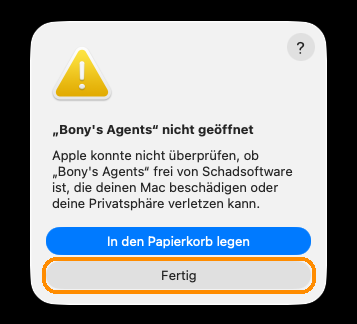
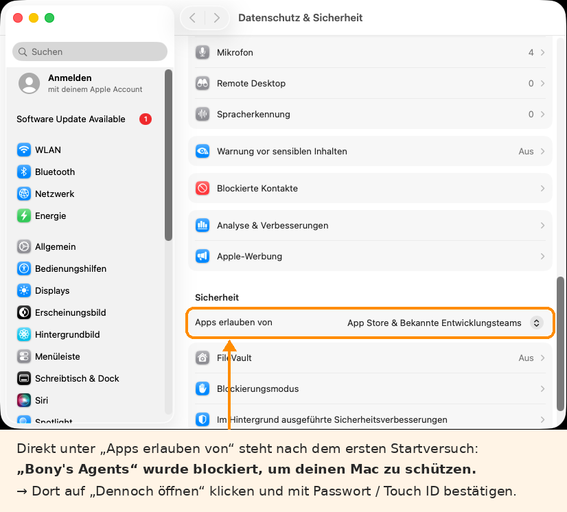

# Bony's Agents


▶ **Videos und Anleitungen:** [youtube.com/@BonysAgents](https://www.youtube.com/@BonysAgents)

**Virtuelle Agent-PCs per Mausklick – mit Brave, Telegram und Hermes Agent.**
Läuft auf Linux, macOS und Windows. Freie Software unter GPL-3.0-or-later.

Bony's Agents erstellt einen eigenen, vom Hauptsystem getrennten Rechner (eine virtuelle
Maschine) mit **Debian 13 „Trixie“** und einem Desktop nach Wahl (Cinnamon, Xfce, KDE Plasma, GNOME, MATE
oder LXQt). Darin sind fertig eingerichtet:

- **Brave Browser** – aus dem offiziellen Brave-Repository; startet ohne Schlüsselbund-Abfrage (`--password-store=basic`, bei neu installiertem Brave)
- **Telegram Desktop** – über Flathub
- **KI-Werkzeuge nach Wahl**, frei kombinierbar – jeweils mit dem offiziellen Installer:
  - **Hermes Agent** – der selbstlernende KI-Agent von Nous Research (Standard)
  - **OpenClaw** – persönlicher KI-Assistent mit Chat-Anbindung (Telegram, WhatsApp u. a.)
  - **Claude Code** – KI-Programmierhilfe von Anthropic im Terminal

Der KI-Agent arbeitet so in seiner eigenen Umgebung: Er kann Programme installieren,
im Browser surfen und Dateien anlegen, ohne an dein eigentliches System zu kommen.

## Funktionen

- Desktop-App mit Übersicht, Start/Stopp, Live-Konsole und Einrichtungs-Fortschritt
- Vollständige Kommandozeile für Skripte und Server (`bonys-agents …`)
- Automatische Anmeldung im Agent-PC, ohne automatische Bildschirmsperre: nach ein paar Minuten ohne Eingabe
  kommt keine Passwortabfrage (der Bildschirmschoner geht mit einem Tastendruck weg; bei neuen Agent-PCs)
- Ressourcen automatisch passend zum Host: alle CPU-Kerne, so viel RAM wie sicher möglich,
  Festplatte von 32 GB bis 1 TB, Standard 64 GB (dynamisch – belegt nur, was wirklich genutzt wird),
  später jederzeit vergrößerbar
- Hardware-Beschleunigung automatisch: KVM (Linux), HVF (macOS), WHPX (Windows),
  mit Software-Rückfallebene
- Läuft auf x86_64 und ARM64 (Apple Silicon)
- Image wird per SHA512 geprüft, Passwort-Daten werden nach der Einrichtung gelöscht
- Speicherort frei wählbar – z. B. eine externe SSD; Agent-PCs werden auf jedem Laufwerk automatisch wiedergefunden
- Fertige Installer: `.deb` für die Paketverwaltung und Setup.exe für Windows
- Fernzugriff per RDP (xrdp, mit Ton) und SPICE (echter Bildschirm, Ton, Zwischenablage) – standardmäßig aus, per Knopf sofort an (bis zum Herunterfahren oder dauerhaft), mit Remmina-Profilen
- Eigenes Hintergrundbild im Agent-PC (Desktop und Anmeldebildschirm, unverzerrt), Git und Build-Werkzeuge vorinstalliert
- Die Auflösung folgt dem QEMU-Fenster wie bei VirtualBox mit Gasterweiterungen – vergrößern, verkleinern, maximieren, Vollbild (Start in 800×600); „Herunterfahren“ wirkt sofort, ohne Rückfrage im Agent-PC
- Updates per Knopfdruck – für die App selbst (signiert und geprüft) und für die Agent-PCs (siehe „Updates“)
- Unterbrochene Einrichtung (QEMU beendet, Neustart, Speichermangel) läuft beim nächsten Start dort weiter, wo sie war
- Selbsttest `bonys-agents selftest`: prüft, ob QEMU auf diesem Rechner startet
- Vorlagen: einen fertig eingerichteten Agent-PC als Vorlage speichern – neue Agent-PCs entstehen daraus in Sekunden, ohne Downloads und Einrichtung (siehe „Vorlagen“)
- Schulungen: Vorlagen als eine `.bonys`-Datei weitergeben – mit Frisch-Prüfung auf Geheimnisse, ohne nicht weitergebbare Programme, mit Prüfsumme (siehe „Schulungen: Agent-PCs weitergeben“)
- **[Bony's VPN](https://github.com/zappotex/bonys-vpn)** (eigenes Projekt): eigene WireGuard-Tunnel im Agent-PC und auf dem eigenen Linux-Rechner, mit Kill-Switch (siehe „VPN“)
- Optional **Obsidian** für Notizen im Agent-PC (siehe „Obsidian“)
- Optional **[Mission Control](https://github.com/zappotex/bonys-agents-mission-control)** (eigenes Projekt):
  Übersicht und Steuerzentrale für deine Agenten im Browser, läuft mit Docker nur im Agent-PC (siehe „Mission Control“)
- Weitere Programme lassen sich als kleines Modul ergänzen (siehe `src/bonys_agents/apps.py`)

## Installation – ganz ohne Terminal

### Welche Version brauche ich?

| Du möchtest … | Version |
|---|---|
| eigene Agent-PCs nutzen **oder an einer Schulung teilnehmen** (Kurs beitreten, Vorführung ansehen, Hilfe anfordern) | **Bony's Agents** |
| selbst **Schulungen geben** (Vorlage im Netz freigeben, vorführen, Hilfe-Anfragen annehmen) | **Bony's Agents Kursleiter** |

Teilnehmer brauchen nur die normale Version. Die Kursleiter-Version enthält alles aus der normalen; Dateien mit
„Kursleiter“ im Namen (`bonys-agents-kursleiter_…deb`, `BonysAgents-Kursleiter-Setup-….exe`,
`BonysAgents-Kursleiter-…-macos-….dmg`). Wechseln geht jederzeit in beide Richtungen – einfach die andere Version
installieren, Agent-PCs, Vorlagen und Einstellungen bleiben. Details: [docs/editionen.md](docs/editionen.md).

Lade auf der **[Releases-Seite](https://github.com/zappotex/BonysAgents/releases/latest)** die Datei für dein
System herunter (hier die normale Version):

| System | Datei | So geht's |
|---|---|---|
| **Windows 10/11** | `BonysAgents-Setup-0.15.0.exe` | Doppelklick → „Weiter“ → „Installieren“. Der Installer richtet QEMU und die Hardware-Beschleunigung gleich mit ein. Danach ggf. einmal neu starten. |
| **Debian, Ubuntu, Linux Mint** | `bonys-agents_0.15.0_amd64.deb` (ARM: `_arm64.deb`) | Doppelklick → die Softwareverwaltung öffnet sich → „Installieren“. QEMU wird automatisch mitinstalliert. |
| **Mac mit Apple-Chip** (M1, M2, M3 …) | `BonysAgents-0.15.0-macos-applesilicon.dmg` | Öffnen, „Bony's Agents“ auf „Programme“ ziehen. Beim ersten Start: siehe [macOS](#macos). |
| **Mac mit Intel-Prozessor** | `BonysAgents-0.15.0-macos-intel.dmg` | wie oben |

Danach findest du **„Bony's Agents“** im Startmenü bzw. Anwendungsmenü.
Deinstallieren geht wie bei jedem anderen Programm – deine Agent-PCs bleiben dabei erhalten.

<details>
<summary>Für Fortgeschrittene: Installation aus dem Quellcode</summary>

**Linux:** `./install.sh` (fragt einmal nach dem Passwort)
**Windows:** `install.cmd` doppelklicken
**Entwicklung:** `pip install -e ".[dev]"`

</details>

### Pakete selbst bauen

| Paket | Befehl |
|---|---|
| `.deb` | `packaging/linux/build-deb.sh` → `dist/bonys-agents_<version>_<arch>.deb`, mit `kursleiter` → `dist/bonys-agents-kursleiter_…deb` |
| Windows-Setup | `packaging\windows\build-setup.cmd` doppelklicken (auf einem Windows-PC) → `dist\BonysAgents-Setup-<version>.exe` und `dist\BonysAgents-Kursleiter-Setup-<version>.exe` |
| macOS-App | `pip install . pyinstaller && pyinstaller packaging/bonys-agents.spec [-- --edition kursleiter]`, dann `packaging/macos/sign.sh` und `packaging/macos/build-dmg.sh` (auf einem Mac) |
| Alles auf einmal | Auf GitHub ein Tag `v0.19.0` anlegen – die Aktion *Release* baut beide Editionen: `.deb` (amd64 + arm64), Setup.exe und die macOS-Apps (Apple-Chip + Intel), testet sie (auch den Wechsel zwischen den Editionen), signiert alles und veröffentlicht es (Anleitung: [docs/RELEASE.md](docs/RELEASE.md)) |

### Was die App selbst erledigt

Fehlt später etwas (z. B. nach einem System-Update), meldet sich beim Start der
Assistent **„Rechner vorbereiten“** und richtet es per Knopfdruck wieder ein.
In der Kommandozeile geht das mit `bonys-agents setup`.

| | Linux | Windows | macOS |
|---|---|---|---|
| QEMU | Paketmanager (apt, dnf, pacman, zypper) | winget | Homebrew |
| Beschleunigung | KVM-Zugriff für deinen Benutzer | Windows-Hypervisorplattform | eingebaut (HVF) |
| Rechte | einmal Passwort (sudo/pkexec) | einmal Windows-Zustimmung | nur wenn Homebrew fehlt: dessen Installer fragt im Terminal |

Nur wenn die Virtualisierung im **BIOS/UEFI** ausgeschaltet ist (Intel VT-x bzw.
AMD-V/SVM), musst du selbst ran – das kann kein Programm von innen ändern.

## macOS

**Voraussetzung: macOS 14 (Sonoma) oder neuer** – auf einem Mac mit Apple-Chip oder Intel-Prozessor.
Ältere Versionen gehen nicht: Qt (die Bibliothek für die Fenster der App) braucht seit Version 6.12
macOS 14, und Homebrew unterstützt ältere Versionen nicht mehr.
Welcher Chip steckt drin? Apple-Menü  → „Über diesen Mac“: Steht dort „Chip Apple M…“, ist es die
`applesilicon`-Datei, steht dort „Prozessor Intel …“, die `intel`-Datei.

### Erster Start

Bony's Agents ist nicht von Apple notarisiert (das kostet ein bezahltes Apple-Entwicklerkonto). Darum
fragt macOS beim **allerersten** Start einmal nach – danach startet die App ganz normal.

**macOS 15 (Sequoia) und neuer**

1. Die `.dmg` öffnen und „Bony's Agents“ auf **„Programme“** ziehen. Dann Bony's Agents im Ordner
   „Programme“ doppelklicken. macOS meldet *„Bony's Agents“ nicht geöffnet* → **„Fertig“** klicken
   (nicht „In den Papierkorb legen“).

   

2. Apple-Menü  → **Systemeinstellungen** → **Datenschutz & Sicherheit**, ganz nach unten zu
   **„Sicherheit“** scrollen. Dort steht *„Bony's Agents“ wurde blockiert …* → **„Dennoch öffnen“**
   klicken und mit dem Mac-Passwort bzw. Touch ID bestätigen.

   

3. Bony's Agents noch einmal öffnen und im Dialog **„Dennoch öffnen“** wählen.

**macOS 14 (Sonoma):** Im Ordner „Programme“ mit der **rechten Maustaste** (oder ctrl-Klick) auf
Bony's Agents → **„Öffnen“** → im Dialog noch einmal **„Öffnen“**.

**Klappt das nicht** (etwa die Meldung *„ist beschädigt und kann nicht geöffnet werden“*): Programm
**Terminal** öffnen (Programme → Dienstprogramme) und eingeben:

```bash
xattr -cr "/Applications/Bony's Agents.app"
```

Das entfernt nur die „aus dem Internet geladen“-Markierung; danach startet die App normal.
Die `.dmg` enthält dieselbe Anleitung als Textdatei „Zuerst lesen – erster Start“.

### QEMU auf dem Mac

Beim ersten Start meldet sich **„Rechner vorbereiten“**. „Automatisch einrichten“ installiert QEMU über
[Homebrew](https://brew.sh), den bekanntesten Paketmanager für macOS. Fehlt Homebrew, erklärt die App
das und öffnet auf Wunsch ein Terminal-Fenster mit dem **offiziellen Installer** von brew.sh – dort
bestätigst du selbst mit der Eingabetaste und deinem Mac-Passwort; danach wird QEMU gleich mitinstalliert.
Auf Macs mit Apple-Chip dauert das wenige Minuten. **Intel-Macs:** Homebrew bietet für Intel inzwischen
oft keine fertigen Pakete mehr an – dann baut der Mac QEMU selbst, das kann 30–60 Minuten dauern.

- Homebrew liegt auf Macs mit Apple-Chip unter `/opt/homebrew`, auf Intel-Macs unter `/usr/local`.
  Die App sucht QEMU dort selbst (aus dem Finder gestartete Apps kennen diese Ordner sonst nicht).
- Macs mit Apple-Chip bekommen das **ARM64**-Debian-Image (Maschine `virt` mit der UEFI-Firmware
  `edk2-aarch64-code.fd` aus Homebrew-QEMU), Intel-Macs das **amd64**-Image.
- Hardware-Beschleunigung über **HVF** (Hypervisor.framework) ist bei jedem halbwegs aktuellen Mac
  eingebaut. Läuft macOS selbst in einer virtuellen Maschine, fehlt HVF – dann ist alles sehr langsam.
- `bonys-agents doctor` zeigt auf dem Mac Chip, Homebrew, QEMU-Pfad und HVF an. Die Kommandozeile
  liegt in der App: `"/Applications/Bony's Agents.app/Contents/MacOS/bonys-agents" doctor`.
- Hast du versehentlich die Intel-Version auf einem Mac mit Apple-Chip installiert, läuft sie über
  Rosetta; die App weist darauf hin, und das nächste Update holt automatisch die richtige Version.

## Benutzung

### Desktop-App

`bonys-agents` (oder `bonys-agents gui`) starten → **„+ Neuer Agent-PC“** →
Name, Passwort, Ressourcen und Programme wählen → **Erstellen und starten**.

Der Agent-PC ist ein Debian 13 mit dem gewählten Desktop (Standard: Cinnamon), deutscher Sprache und Tastatur.
Brave, Telegram und Hermes Agent liegen als Symbole auf dem Schreibtisch.

Beim ersten Mal wird das offizielle Debian-13-Cloud-Image (ca. 450 MB) geladen. Danach richtet sich der
Agent-PC unsichtbar im Hintergrund selbst ein; den Fortschritt siehst du live in der App.
Je nach Rechner und Internet dauert das 15–60 Minuten. Danach schaltet er sich kurz aus und
öffnet sich automatisch im Fenster (anfangs 800×600) mit fertigem Desktop – war die App da gerade zu,
passiert das beim nächsten Öffnen der App. Wird die Einrichtung unterbrochen (QEMU beendet,
Rechner neu gestartet, zu wenig Arbeitsspeicher), zeigt die App „Einrichtung abgebrochen“ samt
vermuteter Ursache – ein Klick auf „Einrichtung fortsetzen“ macht beim unterbrochenen Schritt weiter;
erledigte Schritte werden übersprungen.

Während der unsichtbaren Einrichtung zeigt **„Trotzdem anzeigen“** die Konsole groß und bietet
**„Terminal im Agent-PC öffnen“** (SSH mit Benutzer und Passwort des Agent-PCs) sowie
**„Einrichtungsprotokoll holen“** (kopiert `/var/log/bonys-agents.log` und
`/var/log/cloud-init-output.log` in den Ordner des Agent-PCs). **„Protokolle öffnen“** öffnet diesen
Ordner – dort liegen auch die Konsolenausgaben früherer Starts (`console-<Datum>.log`).

> **Ohne Hardware-Beschleunigung** (Beschleuniger „tcg“) kann die Einrichtung mehrere Stunden dauern.
> Läuft Bony's Agents selbst in einer virtuellen Maschine, dort die *verschachtelte Virtualisierung*
> (nested virtualization) einschalten.

### Kommandozeile

```bash
bonys-agents setup                         # QEMU & Beschleunigung automatisch einrichten
bonys-agents selftest                      # prüfen, ob QEMU auf diesem Rechner startet
bonys-agents create mein-agent             # anlegen und starten (fragt nach Passwort)
bonys-agents create mein-agent --wait      # … und warten, bis alles eingerichtet ist
bonys-agents create mein-agent --agents hermes,claude-code   # KI-Werkzeuge wählen (oder: none)
bonys-agents apps                          # alle Programme und KI-Werkzeuge
bonys-agents apps mein-agent               # installierte und noch verfügbare Programme
bonys-agents install mein-agent openclaw mission-control   # nachträglich installieren (Agent-PC läuft)
bonys-agents mission-control mein-agent status   # … open | update | uninstall [--purge] | forward on|off
bonys-agents connect mein-agent --rdp      # Verbindung öffnen (oder --spice)
bonys-agents remote mein-agent on          # Fernzugriff sofort an, bis zum Herunterfahren (off = aus)
bonys-agents remote mein-agent on --permanent   # … dauerhaft, auch nach Neustarts
bonys-agents display mein-agent spice      # SPICE-Fenster statt QEMU-Fenster
bonys-agents screen mein-agent             # Bildschirm-Einstellung anzeigen
bonys-agents screen mein-agent fixed --size 1600x900   # feste Auflösung (scale = Bild skalieren, auto = Standard)
bonys-agents fullscreen mein-agent         # QEMU-Fenster als Vollbild (zurück mit Strg+Alt+F)
bonys-agents display-driver mein-agent     # Anzeige-Treiber in älteren Agent-PCs nachrüsten
bonys-agents list                          # alle Agent-PCs
bonys-agents status mein-agent             # Details, Fortschritt, SSH-Befehl
bonys-agents logs mein-agent               # Konsolenausgabe
bonys-agents stop mein-agent               # sauber herunterfahren (nach 90 s notfalls hart aus)
bonys-agents stop mein-agent --force       # sofort ausschalten
bonys-agents start mein-agent              # wieder starten – mit Fenster (--headless = ohne)
bonys-agents start mein-agent --wait       # unterbrochene Einrichtung fortsetzen und abwarten
bonys-agents upgrade mein-agent            # Agent-PC aktualisieren (--all = alle laufenden)
bonys-agents update --check                # gibt es eine neue Version von Bony's Agents?
bonys-agents update                        # … und installieren (fragt vorher)
bonys-agents resize mein-agent 128        # Festplatte auf 128 GB vergrößern (ausgeschaltet)
bonys-agents delete mein-agent             # löschen
```

Wichtige Optionen für `create`:

| Option | Bedeutung | Standard |
|--------|-----------|----------|
| `--cpus N` | CPU-Kerne | alle Kerne des Hosts |
| `--ram MB` | Arbeitsspeicher | Host-RAM minus Reserve |
| `--disk GB` | Festplatte, 32 bis 1024 | 64 |
| `--user NAME` | Benutzer im Agent-PC | `agent` |
| `--apps a,b` | Programme und KI-Werkzeuge (`bonys-agents apps`) | brave,telegram,hermes |
| `--agents a,b` | nur die KI-Werkzeuge: hermes, openclaw, claude-code oder none | hermes |
| `--keyboard` | Tastaturlayout | `de` |
| `--headless` | ohne Fenster (z. B. auf einem Server) | – |

### Hermes einrichten

Im Agent-PC das Symbol **Hermes Agent** auf dem Desktop öffnen und einmalig ausführen:

```bash
hermes setup     # Modell bzw. API-Schlüssel wählen, optional Telegram-Bot verbinden
hermes doctor    # Installation prüfen
```

### OpenClaw einrichten

Symbol **OpenClaw** öffnen. Beim ersten Mal startet die Ersteinrichtung (`openclaw onboard`):
Modell wählen, anmelden bzw. API-Schlüssel eingeben, optional einen Chat verbinden. Danach
startet das Symbol direkt `openclaw`. Der Gateway-Dienst wird dabei bewusst **nicht** als
Dauerdienst eingerichtet und lauscht nur innerhalb des Agent-PCs – nach außen ist nichts offen.

### Claude Code einrichten

Symbol **Claude Code** öffnen – es startet `claude` im Ordner `~/Projekte`.
**Claude Code braucht ein eigenes Claude-Konto** (Abo wie Pro/Max oder ein API-Konto;
der kostenlose Plan reicht nicht). Die Anmeldung erfolgt beim ersten Start im Agent-PC über
den offiziellen Weg im Browser (Brave). Bony's Agents legt **keine** Zugangsdaten an und
verändert Claude Code nicht.

### Programme nachträglich hinzufügen

Bei einem laufenden Agent-PC in der Detailansicht unter „Programme“ auf
**„Programme hinzufügen …“** klicken (oder `bonys-agents install NAME APP [APP …]`). Abhängigkeiten
(z. B. Docker für Mission Control) kommen automatisch mit. Die Installation läuft über den Gast-Agent;
antwortet der nicht, per SSH – das Passwort des Agent-PCs wird dann nur dafür verwendet und nicht gespeichert.
Jedes fertige Programm steht sofort in `vm.json`: Bricht etwas ab (Fenster zu, Agent-PC aus, kein Netz),
einfach erneut installieren – fertige Programme werden übersprungen, ein noch laufender alter Versuch im
Agent-PC wird abgewartet. `bonys-agents apps NAME` zeigt, was installiert ist (mit Version).

### Desktop wählen

Im Dialog **„Neuer Agent-PC“** unter **„Desktop“** (oder `bonys-agents create NAME --desktop xfce`).
Alle Desktops kommen aus Debian 13. Liegt der eingestellte Arbeitsspeicher unter der Empfehlung,
warnt die App.

| Desktop | `--desktop` | RAM ab | Download | Passt gut, wenn … |
|---|---|---|---|---|
| **Cinnamon** (Standard) | `cinnamon` | 3 GB | ≈ 370 MB | du eine klassische Bedienung wie unter Windows magst |
| **Xfce** | `xfce` | 2 GB | ≈ 110 MB | der Rechner wenig Arbeitsspeicher hat – leicht und schnell |
| **KDE Plasma** | `kde` | 4 GB | ≈ 910 MB | du viel einstellen willst und genug Speicher und Platz hast |
| **GNOME** | `gnome` | 4 GB | ≈ 560 MB | du die schlichte GNOME-Bedienung mit Übersicht und Dash magst |
| **MATE** | `mate` | 2 GB | ≈ 280 MB | du es klassisch und sparsam willst (Nachfolger von GNOME 2) |
| **LXQt** | `lxqt` | 1,5 GB | ≈ 280 MB | der Rechner sehr schwach ist |

Download = zusätzliche Pakete des Desktops (gemeinsame Pakete wie Schriften und Gast-Werkzeuge
kommen bei allen dazu). `bonys-agents desktops` zeigt die Liste auch im Terminal.

Für alle Desktops gleich:

- **Anmeldung: LightDM mit automatischer Anmeldung.** Er startet jede X11-Sitzung zuverlässig und
  passt schon den Anmeldebildschirm an die Fenstergröße an. KDE empfiehlt SDDM – wird nicht
  installiert, LightDM startet Plasma (X11) problemlos. **Ausnahme GNOME: GDM** – unter LightDM
  schaltet GNOME 48 die Bildschirmsperre ab („erfordert den GNOME Display-Manager“); GDM läuft
  ohne Wayland und meldet automatisch in `gnome-xorg` an.
- **X11-Sitzungen**, auch bei KDE (`plasmax11`) und GNOME (`gnome-xorg`): Fernzugriff per xrdp,
  spice-vdagent und die Anpassung der Auflösung brauchen X11.
- **Hintergrundbild** skaliert mit dunklem Rand – je Desktop über dessen eigene Einstellung
  (gsettings bei Cinnamon/GNOME/MATE, xfconf bei Xfce, Plasma-Skript bei KDE, pcmanfm-qt bei LXQt).
- **„Herunterfahren“** in der App fährt sofort herunter, ohne Rückfrage im Agent-PC – über den
  QEMU-Gast-Agent (kein Desktop kann das abfangen), notfalls per ACPI-Ausschaltknopf.
- **Verknüpfungen** (Hermes, OpenClaw, Claude Code) öffnen das Terminal des Desktops
  (gnome-terminal, xfce4-terminal, konsole, mate-terminal, qterminal). GNOME zeigt keine
  Schreibtisch-Symbole – dort stehen die Programme im Dash.
- Der **Fernzugriff per RDP** startet denselben Desktop.

**Desktop hinzufügen …** (Detailansicht, bei laufendem Agent-PC; oder
`bonys-agents add-desktop NAME xfce [--keep-default]`) installiert einen weiteren Desktop und meldet
künftig automatisch dort an. Der bisherige bleibt installiert und lässt sich am Anmeldebildschirm
weiter wählen. Vorlagen merken sich den Desktop.

### Bildschirm und Vollbild

Die Auflösung des Agent-PCs folgt der Größe des QEMU-Fensters – einfach am Fensterrand ziehen,
maximieren oder **„Vollbild“** in der App drücken (bzw. Strg+Alt+F im Fenster). Der Vollbildmodus
erscheint auf dem Monitor, auf dem das Fenster gerade liegt. Auch der Anmeldebildschirm zieht mit.

So funktioniert es: QEMU meldet die Fenstergröße über die virtuelle Grafikkarte (virtio-gpu mit EDID)
als bevorzugte Auflösung an den Gast. Im Agent-PC sorgt eine udev-Regel bei jedem Hotplug-Ereignis
dafür, dass Anmeldebildschirm und Cinnamon umschalten (kurz entprellt, damit beim Ziehen nicht ständig
umgeschaltet wird).

Unter **„Bildschirm“** in der Detailansicht (oder `bonys-agents screen`) gibt es als Rückfallebene:

| Einstellung | Was passiert |
|---|---|
| Auflösung folgt dem Fenster (Standard) | wie oben |
| Bild skalieren (Zoom to Fit) | feste Auflösung im Agent-PC, QEMU zieht das Bild aufs Fenster |
| Feste Auflösung | feste Auflösung, das Fenster ist genau so groß |

Die Einstellung gilt ab dem nächsten Start. Agent-PCs aus älteren Versionen bekommen den nötigen
Anzeige-Treiber über **„Agent-PC aktualisieren“** oder **„Anzeige-Treiber aktualisieren“** (danach einmal
neu starten). Im **SPICE-Fenster** (Remmina bzw. remote-viewer) passt der SPICE-Client die Auflösung an.

> Cinnamon zeichnet ohne 3D-Grafik per Software (llvmpipe). Nach einem Größenwechsel kann es dabei
> selten abstürzen (Fehler in Mesa/Muffin). Bony's Agents startet Cinnamon dann automatisch neu – offene
> Fenster bleiben erhalten. Das Hintergrundbild wird nach einem Wechsel erst nach einigen Sekunden
> wieder ganz scharf.

## Vorlagen

Ein fertig eingerichteter Agent-PC lässt sich als **Vorlage** speichern. Neue Agent-PCs entstehen
daraus in Sekunden – ohne erneuten Download und ohne Einrichtung.

### Vorlage erstellen

In der Detailansicht eines fertig eingerichteten Agent-PCs **„Als Vorlage speichern …“** wählen,
Name und Beschreibung eingeben. Der Agent-PC wird dafür heruntergefahren (bzw. muss aus sein).

- **Das Original bleibt unverändert.** Über seine Festplatte kommt eine Überlagerung
  (qcow2 mit Backing-File). Nur diese Kopie startet – ohne Internet –, wird verallgemeinert und
  heruntergefahren. Daraus entsteht mit `qemu-img convert -c` die komprimierte Vorlage, danach wird
  die Überlagerung gelöscht. Solange das läuft, lässt sich das Original nicht starten.
- **Verallgemeinern:** cloud-init zurücksetzen (Klone starten als neue Instanz), `/etc/machine-id`
  leeren, SSH-Host-Schlüssel löschen (werden beim ersten Start neu erzeugt), Befehlsverläufe,
  Paket-Cache, Protokolle, temporäre Dateien – und der freie Platz wird genullt (`fstrim`), damit die
  Vorlage klein wird.
- **„Persönliche Daten entfernen“** (Standard: an) löscht zusätzlich im Home des Benutzers:
  Telegram-Anmeldung und -Sitzungen, das Brave-Profil (Logins, Passwörter, Cookies, Verlauf),
  den Schlüsselbund, bei Hermes Konfiguration, API-Schlüssel (`.env`), Gedächtnis und Sitzungen,
  bei OpenClaw Konfiguration und Zugangsdaten, Claude Code (`~/.claude`, `~/.claude.json`),
  SSH-Schlüssel, Git-Zugangsdaten, Online-Konten sowie eigene Dateien in Downloads, Dokumente usw.
  **Die Programme selbst bleiben installiert.** Der Dialog zeigt die vollständige Liste; mit
  **„Im Agent-PC nachsehen (Probelauf)“** startet kurz eine Kopie und listet auf, was dort tatsächlich
  gelöscht würde – ohne etwas zu ändern.
- Zum Schluss wird die Vorlage mit `qemu-img check` geprüft. Sie liegt neben den Agent-PCs unter
  `<Speicherort>/_templates/<Name>/` (`disk.qcow2` und `template.json` mit Name, Beschreibung,
  Datum, Debian-Version, Architektur, Apps, Größe und ursprünglichem Agent-PC).

### Agent-PC aus einer Vorlage

Im Dialog **„+ Neuer Agent-PC“** oben unter **„Grundlage“** die Vorlage wählen:

- **Schnell (verknüpft):** Die neue Festplatte baut auf der Vorlage auf und speichert nur die
  Änderungen – sofort fertig, braucht kaum Platz. Die Vorlage muss dafür auf demselben Laufwerk
  liegen und dort bleiben (Standard, wenn das der Fall ist).
- **Unabhängig (vollständige Kopie):** braucht mehr Platz und etwas Zeit, funktioniert aber auch
  ohne die Vorlage (Standard bei einem anderen Laufwerk).

Beim ersten Start bekommt der Agent-PC einen neuen Rechnernamen, das im Dialog gewählte Passwort,
eine eigene machine-id und neue SSH-Schlüssel; eine größer gewählte Festplatte wird automatisch
genutzt. Es gibt keine Einrichtung – er startet gleich mit Desktop. Die Programme kommen aus der
Vorlage; „Programme hinzufügen …“ funktioniert danach wie gewohnt.

### Vorlagen verwalten

Knopf **„Vorlagen“** im Hauptfenster: Liste mit Größe, Datum und Anzahl verknüpfter Agent-PCs,
dazu Umbenennen, Beschreibung ändern, Löschen, Exportieren und Importieren. Vorlagen werden auf
allen Speicherorten gefunden, auch auf Wechsellaufwerken.

- **Löschen** ist gesperrt, solange verknüpfte Agent-PCs darauf aufbauen. Die App bietet dann an,
  diese vorher zu unabhängigen Kopien zu machen (`qemu-img rebase`).
- **Weitergeben (.bonys) …** speichert die Vorlage als eine Datei – mit Frisch-Prüfung, siehe
  [Schulungen: Agent-PCs weitergeben](#schulungen-agent-pcs-weitergeben). Importieren: Knopf
  „Importieren …“ oder die Datei einfach ins Fenster „Vorlagen“ ziehen (auch das alte Format
  `.bonys-template` bis 0.16).
- Fehlt die Vorlage eines verknüpften Agent-PCs (Laufwerk nicht eingesteckt), steht er als
  „nicht verfügbar – Vorlage fehlt“ in der Liste. Wird er auf ein anderes Laufwerk verschoben, wird er
  automatisch zu einer unabhängigen Kopie. „Unabhängig machen …“ geht auch von Hand.

### Kommandozeile

```bash
bonys-agents template create agent-pc-1 basis -d "Brave, Telegram, Hermes"   # Vorlage erstellen
bonys-agents template create agent-pc-1 basis --dry-run   # nur nachsehen, was gelöscht würde
bonys-agents template create agent-pc-1 basis --keep-personal-data   # Anmeldungen behalten (nicht weitergeben!)
bonys-agents template list
bonys-agents template rename basis basis-2026
bonys-agents template describe basis "Neuer Text"
bonys-agents template export basis [~/Kurs] [--creator "Kursleitung"] [--version 1.0] [--clean]
bonys-agents template import ~/basis-1.0.bonys [--name anderer-name] [--create neuer-pc] [--recipe neuer-pc]
bonys-agents template delete basis [--make-independent]
bonys-agents create neu --template basis [--linked|--full] [--disk 128] [--wait]
bonys-agents make-independent neu       # verknüpften Agent-PC unabhängig machen
```

## Schulungen: Agent-PCs weitergeben

> Freigeben, Vorführen und Hilfe-Anfragen annehmen gibt es in **Bony's Agents Kursleiter**. Teilnehmer
> (Datei importieren, Kurs beitreten, Vorführung ansehen, Hilfe anfordern) brauchen nur die normale Version –
> siehe [Welche Version brauche ich?](#welche-version-brauche-ich)

Für Kurse und Workshops: Der Kursleiter richtet einen Agent-PC einmal ein, macht daraus eine **frische
Vorlage** und gibt sie als **eine Datei** (`NAME-VERSION.bonys`) weiter – per USB-Stick, Netzlaufwerk oder
Cloud. Die Teilnehmer importieren sie und haben in Minuten denselben Agent-PC, ohne Downloads und
Einrichtung.

### Weitergeben (Kursleiter)

„Vorlagen“ → Vorlage wählen → **„Weitergeben (.bonys) …“** (oder `bonys-agents template export NAME`).
Ersteller, Version und optional ein Vorschaubild eintragen, dann **„Prüfen und exportieren“**.

Die Vorlage selbst bleibt dabei unverändert – alles passiert in einer Kopie ohne Netz:

1. **Frisch-Prüfung:** Die Kopie startet und wird nach Resten durchsucht: API-Schlüssel und Token-Dateien
   (z. B. `~/.hermes/.env`, Claude, OpenClaw, GitHub, npm, Docker), `/etc/wireguard`, SSH-Schlüssel,
   Browser-Profile (Verlauf, Cookies, Logins), Telegram-Sitzung, Schlüsselbund, Geheimnisse und Daten von
   Mission Control, Befehlsverläufe. Funde werden mit Art und Ort angezeigt – **nie mit Inhalt** – und
   **blockieren den Export**. „In der Kopie bereinigen und exportieren“ (`--clean`) entfernt sie nur in
   der Export-Kopie.
2. **Lizenzen:** Programme, die nicht frei weitergegeben werden dürfen (**Claude Code**, **Obsidian**),
   werden aus der Kopie entfernt. In der Datei steht dann „beim Empfänger neu installieren (offizielle
   Quelle)“.
3. Passwörter werden gesperrt, die Kopie wird verallgemeinert (wie beim Erstellen einer Vorlage) und
   **noch einmal streng geprüft** – jetzt auch SSH-Hostschlüssel, Maschinen-ID und Passwort-Hashes.
4. Die Festplatte wird komprimiert (`qemu-img convert -c`, eigenständig) und mit SHA-256-Prüfsumme in die
   Datei geschrieben.

Vorlagen mit persönlichen Daten (Klone) lassen sich nur „frisch gemacht“ weitergeben. Der Export zeigt den
Fortschritt in Prozent und lässt sich jederzeit abbrechen (es bleibt nichts liegen).

### Importieren (Teilnehmer)

Die `.bonys`-Datei ins Fenster „Vorlagen“ ziehen (oder „Importieren …“, bzw.
`bonys-agents template import DATEI`). Angezeigt wird, was drin ist: Ersteller, Programme mit Versionen,
Desktop, Debian-Version, Architektur, Größe und empfohlene Ausstattung. Beim Import wird die Prüfsumme
geprüft – eine beschädigte oder veränderte Datei wird abgelehnt. Optional entsteht gleich ein neuer
Agent-PC daraus (Name, Speicherort, RAM und CPUs wählbar; `--create NAME`).

Beim ersten Start bekommt jeder Agent-PC eine **eigene Identität**: neue Maschinen-ID, neue
SSH-Hostschlüssel, ein eigenes Passwort und neue Geheimnisse für Mission Control.
Nicht mitgelieferte Programme (z. B. Claude Code) schlägt **„Programme hinzufügen …“** danach schon
ausgewählt vor – sie kommen aus der offiziellen Quelle.

**Andere Architektur:** Eine amd64-Vorlage auf einem Mac mit Apple-Chip (oder umgekehrt) liefe nur
emuliert und sehr langsam. Bony's Agents warnt deutlich und bietet das **Rezept** an: Derselbe Desktop mit
denselben Programmen wird mit dem passenden Debian-Image neu eingerichtet (`--recipe NAME`).

```bash
bonys-agents template export kurs ~/Kurs --creator "Kursleitung" --version 1.0   # → ~/Kurs/kurs-1.0.bonys
bonys-agents template import ~/Downloads/kurs-1.0.bonys --create teilnehmer-pc
bonys-agents template import ~/Downloads/kurs-1.0.bonys --recipe teilnehmer-pc    # andere Architektur
```

Das Format: ein tar mit `manifest.json` (Name, Beschreibung, Ersteller, Datum, Mindestversion von
Bony's Agents, Architektur, Desktop, Debian-Version, Programme mit Versionen, empfohlene Ausstattung,
SHA-256 der Daten), optional `preview.png` und `disk.qcow2`.

### Im Netzwerk freigeben (Kursraum oder VPN)

Ohne Datei-Herumreichen: Der Kursleiter gibt die Vorlage direkt von seinem Rechner frei, die Teilnehmer
laden sie im selben Netz – oder über ein VPN wie Bony's VPN/WireGuard.

**Kursleiter:** „Vorlagen“ → Vorlage wählen → **„Im Netzwerk freigeben …“** → „Freigabe starten“. Die
`.bonys`-Datei wird dafür einmal erzeugt (mit Frisch-Prüfung, siehe oben) und zwischengespeichert, bis sich
die Vorlage ändert. Angezeigt werden:

- der **Freigabe-Code** (z. B. `4711-BONY` – kurz und gut vorlesbar, für jede Freigabe neu),
- die **Adresse(n)** dieses Rechners (Heimnetz, VPN),
- ein **QR-Code** mit Adresse, Code und Fingerabdruck (Inhalt: `bonys://ADRESSE:PORT?code=…&fp=…`),
- der **Fingerabdruck** des Zertifikats (zum Vergleichen),
- die **Teilnehmer** mit Status, Fortschritt und Restzeit, dazu „Freigabe beenden“.

Einstellbar: Port (Standard **47110**), Dauer (Standard 120 Minuten, danach endet die Freigabe von selbst)
und gleichzeitige Downloads (Standard 4 – wer danach kommt, wartet in einer Schlange und sieht seinen Platz).

**Teilnehmer:** Hauptfenster → **„Kurs beitreten“** (Fenster „Schulung beitreten“). Im selben Netz erscheint die Freigabe von selbst
(mDNS/Zeroconf, Dienst `_bonys-agents._tcp`). Im VPN oder wenn nichts erscheint: Adresse und Code eintippen
oder den Link aus dem QR-Code einfügen. Danach zeigt Bony's Agents, was drin ist, und lädt die Vorlage mit
Fortschritt und Restzeit. Ein abgebrochener Download wird beim nächsten Mal **fortgesetzt**. Am Ende wird die
Prüfsumme geprüft, dann geht es weiter wie beim Import (Agent-PC erstellen …).

**Über VPN (z. B. Bony's VPN/WireGuard):** Die automatische Suche (mDNS) reicht nur ins lokale Netz, durch einen
VPN-Tunnel kommt sie nicht. Die Teilnehmer geben dann die **VPN-Adresse** des Kursleiter-Rechners ein – sie
steht im Freigabe-Fenster bei den Adressen (z. B. `10.8.0.1:47110`) – plus Code, oder fügen den Link aus dem
QR-Code ein (dort ist der Fingerabdruck schon enthalten). Kursleiter und Teilnehmer müssen dafür im selben
VPN sein, und das VPN muss Verbindungen zwischen den Teilnehmern erlauben.

**Sicherheit:**

- Verschlüsselt (HTTPS) mit einem **eigenen Zertifikat für jede Freigabe**. Sein Fingerabdruck kommt über
  den QR-Code bzw. die Suche mit oder wird verglichen („Stimmt er mit dem Bildschirm des Kursleiters
  überein?“). Passt er nicht, bricht Bony's Agents ab.
- Zugriff **nur mit Code**. Nach 5 falschen Versuchen ist die Adresse eine Minute gesperrt, nach zu vielen
  Fehlversuchen insgesamt endet die Freigabe.
- **Nur lesend:** Erreichbar sind nur Infos und die eine Datei, sonst nichts auf dem Rechner. Die Freigabe
  läuft nur, solange das Fenster offen ist bzw. bis die Zeit abläuft.
- Firewall: Bony's Agents öffnet **nichts dauerhaft**. Windows fragt beim ersten Freigeben – „Zugriff
  zulassen“, nur für **private Netzwerke**. macOS fragt ggf. nach eingehenden Verbindungen – „Erlauben“.
  Unter Linux ist meist keine Firewall aktiv. Mit ufw den Port nur für die Schulung öffnen
  (`sudo ufw allow 47110/tcp`, danach `sudo ufw delete allow 47110/tcp`), mit firewalld nur vorübergehend
  (`sudo firewall-cmd --add-port=47110/tcp`, ohne `--permanent`).

```bash
bonys-agents share kurs [--port 47110] [--timeout 120] [--max-downloads 4]   # Kursleiter (Strg+C beendet)
bonys-agents join                                              # Teilnehmer: im Netz suchen
bonys-agents join 192.168.1.5:47110 4711-BONY [--create teilnehmer-pc]
bonys-agents join "bonys://192.168.1.5:47110?code=4711-BONY&fp=…"   # Link aus dem QR-Code
```

## Schulungen: Vorführen und Helfen

### Vorführen (Kursleiter zeigt seinen Agent-PC)

Der Kursleiter zeigt den Bildschirm seines Agent-PCs **live im Browser** der Teilnehmer – auf Laptop, Tablet
oder Handy, ohne dass dort etwas installiert sein muss. Die Teilnehmer können **nur zuschauen**.

**Kursleiter:** Agent-PC starten → in der Detailansicht **„Vorführen …“** → Qualität, höchstens Zuschauer
(Standard 30), Dauer (Standard 90 Minuten) und Port (Standard **47120**) wählen → „Vorführung starten“. Vorher
erscheint der Hinweis: *Alle Teilnehmer sehen alles, was im Agent-PC angezeigt wird. Nutze Pause, bevor du
Passwörter oder Tokens eingibst.* Danach zeigt das Fenster:

- den **Code** (z. B. `4711-BONY`) und die **Adresse(n)** zum Eintippen im Browser (`https://192.168.1.5:47120`),
- einen **QR-Code** – mit der Handy-Kamera scannen, der Code ist dann schon eingetragen,
- den **Fingerabdruck** des Zertifikats,
- die **Zuschauer** (Name, Adresse, verbunden/getrennt, wie oft jemand vergeblich tippen oder klicken wollte),
- **„Pause“**: Alle Zuschauer sehen sofort nur noch „Gleich geht's weiter …“ und bekommen **kein einziges Bild**,
  bis „Weiter“ – vorher Passwörter, Tokens oder private Nachrichten eingeben,
- **„Zuschauer entfernen“** (die Adresse ist danach 5 Minuten gesperrt) und **„Vorführung beenden“**.

Die Vorführung endet von selbst nach der eingestellten Zeit und sobald der Agent-PC ausgeschaltet wird.

**Teilnehmer:** Im Browser die angezeigte Adresse öffnen (oder den QR-Code scannen), Name und Code eingeben –
fertig. Das Bild passt sich der Fenstergröße an, „⛶“ schaltet auf Vollbild, oben rechts steht der Status
(verbunden, Pause, beendet). Bricht das WLAN kurz ab, verbindet sich die Seite selbst wieder. Wer Bony's Agents
installiert hat, findet laufende Vorführungen auch unter **„Kurs beitreten“** – sie öffnen sich im Browser.

**Der Browser warnt vor dem Zertifikat** („Verbindung nicht privat“) – das ist bei einem eigenen Zertifikat für
jede Vorführung normal: „Erweitert“ → „Weiter zu …“. Wer sicher gehen will, vergleicht den Fingerabdruck in den
Zertifikatsdetails des Browsers mit dem auf dem Bildschirm des Kursleiters.

**Ton ist nicht dabei** – im Raum sprechen oder zusätzlich z. B. [Jitsi Meet](https://meet.jit.si) nutzen.

**Qualität:** „mittel“ (10 Bilder/s) passt fürs WLAN, „niedrig“ (5) für langsame Netze, „hoch“ (20) für Kabel.
Ab 9 Zuschauern senkt Bony's Agents die Bildrate anteilig, bei hoher Rechenlast ebenfalls (Anzeige im Fenster).

**Sicherheit:**

- **Zuschauen wird erzwungen, nicht nur angezeigt:** Bony's Agents liest jede Nachricht vom Browser zum
  Agent-PC und lässt nur durch, was für das Bild nötig ist. Tastatur, Maus, Zwischenablage, Neustart-Befehle
  und alles Unbekannte werden verworfen (die Browser-Ansicht läuft zusätzlich im Nur-ansehen-Modus). Auch in
  der Gegenrichtung kommt keine Zwischenablage an.
- Der Bildschirm des Agent-PCs ist nur **lokal** erreichbar (QEMU-VNC über einen Unix-Socket, den nur dein
  Benutzer öffnen darf; unter Windows nur über 127.0.0.1) – ins Netz geht er ausschließlich verschlüsselt über
  Bony's Agents, nur mit Code und nur, solange die Vorführung läuft.
- Wie bei der Freigabe: eigenes Zertifikat für jede Vorführung, 5 falsche Codes → eine Minute gesperrt, zu viele
  insgesamt → die Vorführung endet. Firewall-Hinweise wie oben, nur mit Port 47120.
- Agent-PCs, die vor Version 0.18 gestartet wurden, müssen **einmal neu gestartet** werden („Jetzt neu
  starten“ im Fenster) – erst dann stellt QEMU den Bildschirm lokal bereit.

```bash
bonys-agents present kurs-pc [--port 47120] [--timeout 90] [--max-viewers 30] [--quality low|medium|high]
```

### Helfen (Kursleiter sieht den Agent-PC eines Teilnehmers)

Hängt ein Teilnehmer fest, kann der Kursleiter dessen Agent-PC ansehen – und mit einer zweiten Erlaubnis auch
steuern. **Ohne Zustimmung des Teilnehmers sieht der Kursleiter nichts.**

**Kursleiter:** Menü hinter dem ⓘ → **„Kursleitung: Hilfe-Anfragen …“** → „Hilfe-Schalter starten“ (läuft schon
eine Vorführung, gilt derselbe Code). Das Fenster zeigt Code, Adresse, Fingerabdruck und einen Link zum
Weitergeben. Neue Anfragen erscheinen mit Hinweiston in der Liste (Name, Agent-PC, Nachricht, Zeit).
**„Ansehen“** fragt beim Teilnehmer nach; sobald er zustimmt, zeigt der Browser seinen Agent-PC (auf diesem
Rechner, mit einmaliger Zertifikatswarnung). Dort gibt es **„Steuerung anfragen“** (zweite Rückfrage beim
Teilnehmer), „Nur ansehen“ und „Beenden“.

**Teilnehmer:** Beim eigenen Agent-PC **„Hilfe anfordern …“** → Kurs auswählen (im selben Netz wird er gefunden,
sonst den Link vom Kursleiter einfügen oder Adresse und Code eingeben), optional eine kurze Nachricht. Möchte der
Kursleiter zusehen, fragt Bony's Agents: **„Erlauben“ oder „Ablehnen“**. Fürs Steuern kommt eine eigene, zweite
Frage. Solange jemand zusieht oder steuert, steht oben im Fenster ein farbiger Hinweis mit **„Nur ansehen“** und
**„Beenden“** – beides wirkt sofort. Im Agent-PC erscheint zusätzlich eine Desktop-Benachrichtigung (wenn möglich).

**Sicherheit:**

- Die Verbindung geht **vom Teilnehmer zum Kursleiter** (verschlüsselt, mit Code und Fingerabdruck). Der
  Teilnehmer muss keine Ports öffnen – das klappt auch hinter Firewalls, NAT und über VPN.
- Sichtbar ist **nur der Agent-PC**, nie der übrige Bildschirm des Teilnehmers. Die **Zwischenablage wird nie
  übertragen.**
- Ob Tastatur und Maus des Kursleiters ankommen, entscheidet **der Rechner des Teilnehmers** – nur nach seiner
  zweiten Zustimmung und nur, bis er „Nur ansehen“ oder „Beenden“ wählt.
- Die Ansicht beim Kursleiter ist nur auf seinem eigenen Rechner erreichbar, mit einem Schlüssel je Ansicht.
- Beim Teilnehmer wird festgehalten, wann wer zugesehen bzw. gesteuert hat (ohne Bildinhalte):
  `~/.local/share/bonys-agents/schulung/hilfe-protokoll.log` (Windows/macOS: im Datenordner von Bony's Agents).

Ausblick (siehe `docs/plan-schulung.md`): Kursleiter-Übersicht („alle auf Anfang“, Dateien verteilen).

## Fernzugriff (RDP und SPICE)

Jeder Agent-PC ist auf zwei Wegen erreichbar – beides freie Software:

| | RDP (xrdp im Agent-PC) | SPICE (direkt aus QEMU) |
|---|---|---|
| Was du siehst | eigene Desktop-Sitzung | den echten Bildschirm, auch beim Hochfahren |
| Ton | ja | ja |
| Zwischenablage | ja | ja (spice-vdagent) |
| Programme | Remmina, Windows-Remotedesktop, Handy-Apps | Remmina, remote-viewer (virt-viewer) |

Jeder Agent-PC bekommt feste Ports: **RDP ab 3390** (3390, 3391, …) und **SPICE ab 5901**.
Die Verbindungsdaten stehen in der App unter **Fernzugriff** (unten in der Detailansicht) und
bei `bonys-agents status NAME`. Angemeldet wird per RDP mit dem Benutzer **agent** und dessen Passwort.

**Linux (Remmina):** In der App „Remmina installieren“ klicken. Bony's Agents legt für jeden
Agent-PC Profile in der Gruppe „Bony's Agents“ an (ohne Passwörter) – Remmina zeigt so alle
Agent-PCs übersichtlich. „Verbinden (RDP)“ bzw. „Verbinden (SPICE)“ öffnet das passende Profil.

**Windows:** „Verbinden (RDP)“ öffnet die Remotedesktopverbindung (mstsc) – nichts zu installieren.
Für SPICE wird remote-viewer aus *virt-viewer* gebraucht.

**Fernzugriff ist standardmäßig aus:** kein RDP-Port, xrdp im Agent-PC installiert, aber
abgeschaltet; SPICE nur an diesem Rechner (127.0.0.1). Der Knopf **„Fernzugriff einschalten“**
in der Detailansicht (oder `bonys-agents remote NAME on`) wirkt bei laufendem Agent-PC sofort,
ohne Neustart: Die App startet xrdp im Agent-PC über den QEMU Guest Agent (ersatzweise per
SSH, dann mit Passwortabfrage) und richtet die RDP-Weiterleitung im laufenden QEMU ein.
Dabei wählst du:

- **Nur bis zum Herunterfahren** (Standard) – nach dem Herunterfahren oder einem Neustart des
  Agent-PCs ist der Fernzugriff automatisch wieder aus.
- **Dauerhaft** (`--permanent`) – bleibt an, auch nach Neustarts.

Ist der Fernzugriff an, steht in der Liste ein ⇄ hinter dem Namen. Dann gilt die
Heimnetz-Adresse dieses Rechners (z. B. `192.168.178.20:3390`). „Profile für anderen PC
exportieren …“ erzeugt fertige `.remmina`- und `.rdp`-Dateien. Auf dem Handy z. B. eine
RDP-App verwenden und Adresse, Port und Benutzer `agent` eintragen.

**SPICE aus dem Heimnetz** gibt es nur bei „dauerhaft“, und zwar ab dem nächsten Start: QEMU legt
die SPICE-Adresse beim Start fest und kann sie danach nicht mehr ändern. SPICE bekommt dann ein
eigenes, zufälliges Passwort (in der App anzeig- und kopierbar). RDP geht immer sofort.

> **Sicherheit:** Nur im Heimnetz verwenden. Diese Ports **nicht** im Router freigeben.
> Ist eine Firewall aktiv (ufw unter Linux, Windows-Firewall), bietet die App an, die Ports
> **nur fürs lokale Netz** freizugeben – sie fragt vorher immer nach.

**Anzeige:** Pro Agent-PC wählbar – „QEMU-Fenster“ (wie bisher) oder „SPICE-Fenster“
(QEMU läuft ohne eigenes Fenster, die App öffnet Remmina bzw. remote-viewer). Kann der
installierte QEMU kein SPICE (bei manchen Windows- und macOS-Builds), wird SPICE ausgegraut
und RDP bleibt verfügbar.

**Bestehende Agent-PCs:** SPICE, Ton und der Kanal für den Guest Agent wirken automatisch ab dem
nächsten Start. RDP über „Programme hinzufügen …“ → „Fernzugriff (RDP)“ nachrüsten. War bisher
„Fernzugriff aus dem Heimnetz erlauben“ an, gilt das jetzt als „dauerhaft“.

## VPN (Bony's VPN)

[**Bony's VPN**](https://github.com/zappotex/bonys-vpn) ist mein eigenes, kleines Programm für **WireGuard** –
seit Bony's Agents 0.15 ein **eigenes Projekt** mit eigenen Paketen, Updates und Sicherheitskonzept
([`docs/sicherheit.md`](https://github.com/zappotex/bonys-vpn/blob/main/docs/sicherheit.md) dort). Bony's Agents
nutzt es nur: Es installiert es aus dem offiziellen Release und steuert es über die offizielle Kommandozeile
`bonys-vpn … --json` ([`docs/cli.md`](https://github.com/zappotex/bonys-vpn/blob/main/docs/cli.md)). Wie das im
Einzelnen läuft, steht in [`docs/vpn.md`](docs/vpn.md).

Die Konfiguration (`.conf`) bringst du selbst mit, z. B. aus der WireGuard-Funktion deiner Fritzbox oder von
deinem VPN-Anbieter. Bony's Agents legt **keine** Zugangsdaten an.

### Agent-PC oder eigener Rechner?

| | Im Agent-PC | Auf deinem eigenen Rechner |
|---|---|---|
| Was geht durch den Tunnel | nur der Internetverkehr dieses einen Agent-PCs | **alles** auf deinem Rechner: Browser, Mail, Updates und auch die Agent-PCs |
| Programm | App-Option **„WireGuard VPN (Bony's VPN)“** beim Erstellen oder über „Programme hinzufügen …“: Pakete `bonys-vpn` + `bonys-vpn-agentpc` aus dem [Release](https://github.com/zappotex/bonys-vpn/releases/latest) (Signatur und SHA-256 geprüft), im Agent-PC das Symbol „Bony's VPN“ mit Tray-Symbol | **Linux:** Paket `bonys-vpn` – Knopf **„VPN“** oben im Fenster von Bony's Agents öffnet es bzw. installiert es nach Rückfrage. **Windows/macOS:** offizielle WireGuard-App (siehe unten) |
| Rechte | ohne Passwort (der Benutzer im Agent-PC hat ohnehin Administratorrechte) | Administrator-Passwort, einige Minuten gemerkt. Nur den Status anzuzeigen geht ohne Passwort |
| Updates | „Agent-PC aktualisieren“ (APT-Paketquelle) bzw. „VPN-App aktualisieren“ im Reiter „VPN“ | Aktualisierungsverwaltung (APT-Paketquelle) bzw. in Bony's VPN selbst |
| Kommandozeile | `bonys-agents vpn NAME status\|up\|down\|import\|killswitch\|autostart\|ip\|update`, im Agent-PC `bonys-vpn` | `bonys-vpn list\|status\|up\|down\|import\|delete\|rename\|export\|autostart\|killswitch` |

**Im Agent-PC beim Erstellen:** Im Dialog „Neuer Agent-PC“ unter **VPN** „Konfiguration wählen …“,
optional **„Automatisch verbinden“** und **„Kill-Switch“**. Die Datei wird geprüft und nur in diesen
Agent-PC übertragen – auf deinem Rechner bleibt nichts davon liegen (nicht in den Einstellungen, nicht
in Protokollen). Im laufenden Agent-PC zeigt der Reiter **„VPN“** in der Detailansicht Status, Server,
Handshake und Datenmenge, mit Knöpfen zum Verbinden, Trennen, Importieren und für die öffentliche IP.
Kommandozeile: `bonys-agents create NAME --vpn-config DATEI [--vpn-autoconnect] [--killswitch]`.

**Agent-PCs aus Bony's Agents 0.14 oder älter** haben noch die alte, eingebaute Fassung. Bony's Agents stellt sie
beim nächsten Start des Agent-PCs von selbst auf das Paket um (Hinweis unten in der Statusleiste), von Hand
geht es mit **„VPN-App aktualisieren“** im Reiter „VPN“ oder `bonys-agents vpn NAME update`. Tunnel, Schlüssel
und Kill-Switch bleiben dabei, wie sie sind. Ist der Kill-Switch an und kein Tunnel verbunden, erst verbinden.

**Auf deinem Linux-Rechner:** Knopf **„VPN“** oben im Fenster (oder **ⓘ → Extras → Bony's VPN für diesen
Rechner**). Ist Bony's VPN installiert, öffnet er es. Sonst erklärt ein Dialog, was passiert, und
**„Installieren“** holt das Paket `bonys-vpn` aus der offiziellen Quelle – aus der Paketquelle von Bony's Agents
oder aus dem GitHub-Release mit geprüfter Signatur – und fragt dafür nach deinem Passwort. Alles Weitere
(Tunnel importieren, verbinden, Kill-Switch, Tray-Symbol …) macht Bony's VPN selbst, siehe dessen
[README](https://github.com/zappotex/bonys-vpn#readme). Du kannst es auch direkt installieren:
`sudo apt install bonys-vpn` (wenn die Paketquelle von Bony's Agents eingerichtet ist).

> Bis Bony's Agents 0.14 steckte Bony's VPN im .deb von Bony's Agents. Beim Update auf 0.15 bleiben deine
> Tunnel in `/etc/wireguard` erhalten. War der Kill-Switch an und Bony's VPN ist nicht als eigenes Paket
> installiert, schaltet das Update ihn vorher ab – damit dein Rechner nicht ohne Programm offline bleibt.

**Windows:** **ⓘ → Extras → WireGuard für diesen Rechner installieren …** installiert die offizielle
WireGuard-App per winget (`WireGuard.WireGuard`). Ist sie schon da, öffnet der Menüpunkt sie. In der
App „Tunnel aus Datei importieren“ und „Aktivieren“ klicken.

**macOS:** Die offizielle WireGuard-App gibt es nur im **App Store** – einen offiziellen Weg, sie
automatisch zu installieren, gibt es nicht (Homebrew bringt nur die Kommandozeilen-Werkzeuge ohne App).
**ⓘ → Extras → WireGuard für diesen Rechner (App Store) …** öffnet die App-Store-Seite (oder die App,
wenn sie schon installiert ist) und erklärt die Schritte.

### Kill-Switch

Mit Kill-Switch kommt **ohne verbundenen Tunnel kein Programm ins Internet** – auch nicht, wenn der
Tunnel abbricht oder nach einem Neustart (die Sperre lädt, bevor das Netz hochkommt).

- **Im Agent-PC:** Steuerung durch Bony's Agents, Herunterfahren, Fortschritt, RDP/SPICE und SSH gehen
  weiter (das QEMU-Netz `10.0.2.0/24` ist ausgenommen).
- **Auf deinem Rechner** nur nach einer zusätzlichen Warnung: Ohne Tunnel ist dann der **ganze Rechner**
  offline. Agent-PCs starten und laufen weiter (Steuerung, Fernzugriff und Herunterfahren gehen über den
  Rechner selbst), ihr Internet geht aber ebenfalls nur über den Tunnel – neue Agent-PCs also erst nach
  dem Verbinden erstellen. Geräte im Heimnetz (Drucker, NAS) bleiben über **„Ausnahmen …“** erreichbar,
  z. B. `192.168.178.0/24`. Beim Deinstallieren von Bony's VPN wird der Kill-Switch abgeschaltet.

### Vorlagen und Klone

- **Frische Vorlage** („Persönliche Daten entfernen“): alle Tunnel und Schlüssel werden gelöscht,
  automatisches Verbinden und Kill-Switch sind aus. Der freie Platz wird mit Nullen überschrieben, damit
  auch gelöschte Schlüssel nicht in der Vorlage stehen bleiben.
- **Klon** („Persönliche Daten behalten“): alle Tunnel samt Schlüssel bleiben – mit Warnhinweis.
  **Zwei Rechner mit demselben WireGuard-Schlüssel werfen sich gegenseitig aus dem Tunnel.** Für jeden
  Agent-PC, der gleichzeitig laufen soll, eine eigene Konfiguration (eigenen Peer) anlegen. Das gilt
  auch für deinen eigenen Rechner: nicht dieselbe .conf auf dem Rechner und im Agent-PC gleichzeitig.

> **Sicherheit:** Konfigurationen mit `PreUp`/`PostUp`/`PreDown`/`PostDown` führen beim Verbinden
> Befehle als root aus. Bony's VPN übernimmt sie nur nach einer deutlichen Warnung, Bony's Agents
> beim Erstellen gar nicht.

## Obsidian

Die App-Option **„Obsidian (Notizen)“** (standardmäßig aus) installiert die offizielle Obsidian-App aus
dem GitHub-Release von Obsidian (neueste Version, SHA-256 geprüft) – auf x86_64 als .deb, auf ARM64 als
tar.gz nach `/opt/Obsidian`. Auf dem Schreibtisch liegt eine Verknüpfung, der leere Tresor
`~/Agent-Notizen` ist schon geöffnet. Keine Anmeldung, kein Sync, keine Schlüsselbund-Abfrage beim
ersten Start. Nachträglich: „Programme hinzufügen …“ oder `bonys-agents install NAME obsidian`.
In frischen Vorlagen werden Obsidian-Einstellungen und der Inhalt von `~/Agent-Notizen` gelöscht.

Obsidian ist **kostenlos, aber kein Open Source**. Einen geteilten Ordner zwischen deinem Rechner und
dem Agent-PC gibt es absichtlich (noch) nicht – der KI-Agent hätte sonst Zugriff auf deine Dateien.

## Mission Control

**[Bony's Agents Mission Control](https://github.com/zappotex/bonys-agents-mission-control)** ist ein
eigenes Projekt: eine Übersicht und Steuerzentrale für deine Agenten im Browser. Die App-Option
**„Mission Control“** (standardmäßig aus) gibt es beim Erstellen und über „Programme hinzufügen …“.

- **Docker** wird automatisch mitinstalliert – aus der offiziellen Docker-Paketquelle für Debian
  (`docker-ce`, `docker-ce-cli`, `containerd.io`, `docker-buildx-plugin`, `docker-compose-plugin`, amd64 und
  arm64), der Schlüssel wird gegen den veröffentlichten Fingerabdruck geprüft. Der Benutzer `agent` kommt in
  die Gruppe `docker` – das ist im Agent-PC vertretbar, weil er vom eigenen Rechner abgeschottet ist und der
  Benutzer dort ohnehin Administrator ist. Docker-Images und -Daten liegen im Agent-PC.
- **Brave** kommt ebenfalls mit, falls es nicht gewählt ist – die Verknüpfung „Mission Control“ öffnet die
  Oberfläche darin.
- Installiert wird `install.sh` aus einem **festen Release** von Mission Control (diese Version von
  Bony's Agents: 0.1.0), geprüft über eine eingebaute Prüfsumme und die `SHA256SUMS` des Release.
  Bedarf laut `agentpc.json`: ca. 2 GB Festplatte und 512 MB RAM zusätzlich – beim Erstellen warnt der Dialog,
  wenn RAM oder Festplatte knapp sind, und schlägt passende Werte vor.
- Die Oberfläche lauscht **nur im Agent-PC** (`http://127.0.0.1:8787/`); die Verknüpfung „Mission Control“
  auf dem Schreibtisch öffnet sie in Brave.
- Reiter **„Mission Control“** in der Detailansicht: Status (läuft/gestoppt, Healthcheck), **Öffnen** (im
  Agent-PC), **Aktualisieren** (auf das neueste Release; Einstellungen und Daten bleiben),
  **Deinstallieren** (Daten bleiben – löschen nur mit zusätzlicher Bestätigung). Kommandozeile:
  `bonys-agents mission-control NAME status|open|update|uninstall`.
- **Weiterleitung an den eigenen Rechner** (standardmäßig aus): macht Mission Control zusätzlich unter
  `http://127.0.0.1:<Port>/` auf diesem Rechner erreichbar – nur dort, nie im Heimnetz. Jedes Programm auf
  diesem Rechner kann die Oberfläche dann aufrufen; nur einschalten, wenn du sie hier brauchst.
- **Vorlagen:** Eine frische Vorlage setzt die Geheimnisse und Benutzerdaten von Mission Control zurück
  (`reset-secrets.sh`, danach geprüft) – jeder neue Agent-PC erzeugt beim ersten Start eigene. Docker-Images
  bleiben (spart den Download). Ein Klon behält alles.
- Geheimnisse von Mission Control (`.env` im Agent-PC) verlassen den Agent-PC nie: Bony's Agents liest dort
  nur Version, Dienststatus, Healthcheck und Port.

## Welche Programme sind Open Source?

| Programm | Open Source? | Lizenz / Bedingungen |
|---|---|---|
| Bony's Agents | ja | GPL-3.0-or-later |
| [Bony's VPN](https://github.com/zappotex/bonys-vpn) (eigenes Projekt, im Agent-PC als App-Option) | ja | GPL-3.0-or-later |
| [Mission Control](https://github.com/zappotex/bonys-agents-mission-control) (eigenes Projekt, im Agent-PC als App-Option, benötigt Docker) | ja | GPL-3.0-or-later |
| Docker Engine (docker-ce, containerd, Compose, Buildx – für Mission Control) | ja | Apache-2.0 |
| Debian, QEMU | ja | freie Lizenzen (u. a. GPL-2.0) |
| Brave Browser | ja | MPL-2.0 |
| Telegram Desktop | ja | GPL-3.0 |
| Hermes Agent | ja | MIT |
| OpenClaw | ja | MIT |
| xrdp (Fernzugriff), Remmina | ja | Apache-2.0, GPL-2.0-or-later |
| [noVNC](https://github.com/novnc/noVNC) 1.7.0 (Browser-Ansicht beim Vorführen, im Paket mitgeliefert, Lizenztexte unter `resources/novnc/`) | ja | MPL-2.0 (pako: MIT) |
| WireGuard (wireguard-tools, Apps für Windows und macOS) | ja | GPL-2.0, MIT |
| **Claude Code** | **nein** | proprietär (Anthropic). Nutzung braucht ein kostenpflichtiges Claude-Abo oder API-Guthaben |
| **Obsidian** | **nein** | proprietär, für die private Nutzung kostenlos |

## Updates

**Bony's Agents selbst**

- Die App sucht beim Start höchstens einmal am Tag nach einer neuen Version (abschaltbar im Menü
  hinter dem ⓘ neben dem Namen, dort auch „Nach Updates suchen“ und „Testversionen anbieten“).
  Gibt es eine, erscheint oben eine dezente Leiste mit „Was ist neu?“, „Jetzt aktualisieren“ und
  „Später“ – installiert wird nur, wenn du zustimmst.
- **Linux (.deb):** Das Paket richtet eine eigene, signierte Paketquelle ein
  (`/etc/apt/sources.list.d/bonys-agents.sources`). Updates kommen dadurch ganz normal über die
  **Aktualisierungsverwaltung** von Mint, Ubuntu oder Debian. „Jetzt aktualisieren“ in der App macht
  dasselbe sofort (fragt nach deinem Passwort). Beim vollständigen Entfernen des Pakets wird die
  Paketquelle wieder gelöscht.
- **Windows:** „Jetzt aktualisieren“ lädt den neuen Installer, prüft ihn und installiert ihn; die App
  startet danach von selbst neu.
- **macOS:** „Jetzt aktualisieren“ lädt die `.dmg` für deinen Chip (Apple-Chip oder Intel) in den Ordner
  „Downloads“, prüft sie und öffnet sie im Finder. Dort „Bony's Agents“ auf „Programme“ ziehen und
  „Ersetzen“ wählen. Die so geladene Datei fragt Gatekeeper nicht noch einmal ab.
- **Sicherheit:** Nur HTTPS und nur Dateien aus dem offiziellen Release. Jede Datei wird vor der
  Installation gegen die signierte Prüfsummenliste (`SHA256SUMS`, minisign) geprüft – stimmt etwas
  nicht, bricht das Update mit einer klaren Meldung ab.
- Laufende Agent-PCs laufen beim Update weiter; die App fragt vorher, ob sie heruntergefahren werden sollen.
- Kommandozeile: `bonys-agents update --check` bzw. `bonys-agents update`.

**Agent-PCs**

In der Detailansicht eines laufenden Agent-PCs **„Agent-PC aktualisieren“** klicken (oder im Menü
„Alle Agent-PCs aktualisieren“, Kommandozeile `bonys-agents upgrade NAME` bzw. `--all`). Das holt alle
Systemupdates (`apt full-upgrade`), aktualisiert Flatpak-Programme wie Telegram und die installierten
KI-Werkzeuge mit ihren offiziellen Update-Befehlen (z. B. `hermes update`, `claude update`). Die
Ausgabe erscheint live; am Ende meldet die App, ob ein Neustart des Agent-PCs nötig ist.

Für Entwickler: Wie Releases signiert und veröffentlicht werden, steht in [docs/RELEASE.md](docs/RELEASE.md).

## Warum nicht 100 % RAM?

Bekäme die VM den gesamten Arbeitsspeicher, hätte das Host-System nichts mehr übrig und
würde einfrieren – oder das System beendet QEMU wegen Speichermangels. Bony's Agents gibt daher
alles bis auf eine Reserve von 25 % (mindestens 3 GB) frei. CPU-Kerne werden dagegen vollständig geteilt, das ist
unkritisch, weil der Host sie bei Bedarf mitbenutzt.

## Wo liegen die Daten?

| System | Ordner |
|--------|--------|
| Linux | `~/.local/share/bonys-agents/` |
| macOS | `~/Library/Application Support/bonys-agents/` |
| Windows | `%LOCALAPPDATA%\bonys-agents\` |

Jeder Agent-PC hat dort einen eigenen Unterordner unter `vms/`. Vorlagen liegen je Speicherort
im Ordner `_templates/`, heruntergeladene Debian-Images in `_images/`.

## Aufbau des Codes

```
src/bonys_agents/
  host.py        Host erkennen: OS, Architektur, Kerne, RAM, Beschleuniger
  deps.py        QEMU & Beschleunigung prüfen und automatisch installieren
  qemu.py        QEMU finden, Startbefehl bauen, Steuerung über QMP
  images.py      Debian-Cloud-Image laden und prüfen (SHA512)
  cloudinit.py   Einrichtung des Gasts (cloud-init) und Seed-ISO
  apps.py        Installierbare Programme – hier neue ergänzen
  desktops.py    Desktop-Umgebungen (Cinnamon, Xfce, KDE …) – hier neue ergänzen
  vm.py          Lebenszyklus: anlegen, starten, stoppen, löschen, aktualisieren
  templates.py   Vorlagen: erstellen (über eine Überlagerung), klonen, verwalten
  bonysfile.py   Vorlagen weitergeben (.bonys): Frisch-Prüfung, Lizenzen, Manifest, Export/Import, Rezept
  edition.py     Edition des Programms (Bony's Agents bzw. Bony's Agents Kursleiter, siehe docs/editionen.md)
  share.py       Schulung (beide Editionen): Kurs-Protokoll und Version, Code, Fingerabdruck, Beitreten und Laden
  helpmode.py    Hilfe-Modus beim Teilnehmer: Verbindung zum Kursleiter, Zustimmungen, Protokoll
  rfb.py, websocket.py, vncbridge.py  Filter (Eingaben nur mit Erlaubnis), WebSocket, Brücke zum lokalen VNC
  mdns.py        kleines mDNS/DNS-SD: Freigaben finden (_bonys-agents._tcp)
  trainer/       nur Kursleiter-Version: Freigabe-Server (share_server), Vorführen (present, noVNC), Hilfe-Schalter
                 (helpdesk), mDNS-Ankündigung (announce), Befehle share/present (cli), Dialoge (gui/)
  procutil.py    externe Programme mit sauberer Umgebung starten (ohne Bibliotheken des Bundles)
  selftest.py    Selbsttest: startet QEMU wie die App
  diagnose.py    Ursache erkennen, wenn QEMU während der Einrichtung endet
  updates.py     Update-Suche, Download, Signatur- und Prüfsummenprüfung
  signing.py     minisign/Ed25519 (ohne zusätzliche Abhängigkeiten)
  mission_control.py  Mission Control im Agent-PC: Installation aus festem Release, Mindestanforderungen,
                 Status, Öffnen, Update, Deinstallation, Weiterleitung, Vorlagen-Bereinigung
  vpnlink.py     Bony's VPN im Agent-PC: .conf prüfen und übertragen, Status/Steuerung über bonys-vpn --json,
                 Schema-/Versionsprüfung, „VPN-App aktualisieren“ (Bony's VPN selbst: github.com/zappotex/bonys-vpn)
  hostvpn.py     VPN auf dem eigenen Rechner (Linux: Bony's VPN öffnen/installieren, Windows: winget, macOS: App Store)
  cli.py         Kommandozeile
  gui/           Desktop-App (Qt / PySide6) inkl. Einrichtungs-Assistent und Reitern „VPN“ und „Mission Control“
packaging/
  bonys-agents.spec      PyInstaller-Bauplan (Programm inkl. Python & Qt), je Edition (editions.py)
  check-edition.py       prüft ein gebautes Programm: Anwender ohne trainer/ und noVNC, Kursleiter mit
  linux/build-deb.sh     .deb-Paket
  linux/build-apt-repo.sh  signierte APT-Paketquelle (für GitHub Pages)
  windows/*.iss          Windows-Installer (Inno Setup)
  make-resources.py      Logo, Icons und Hintergrundbilder aus Bilder/ erzeugen
install.sh / install.cmd Installation aus dem Quellcode
```

## Mitmachen

Beiträge sind willkommen – siehe [CONTRIBUTING.md](CONTRIBUTING.md). Angenommen werden sie nur mit
Zustimmung zur [Beitragsvereinbarung (CLA)](CLA.md).

## Lizenz

Copyright © 2026 Bony

**Programmcode:** Bony's Agents ist freie Software unter der **GNU General Public License,
Version 3 oder (nach deiner Wahl) jeder späteren Version** (GPL-3.0-or-later) – siehe
[LICENSE](LICENSE). Du darfst das Programm nutzen, untersuchen, verändern und weitergeben;
veränderte Versionen müssen ebenfalls unter der GPL stehen und ihren Quellcode offenlegen.
Bony's Agents wird ohne jede Gewährleistung bereitgestellt.

**Kommerzielle Lizenz:** Wer Bony's Agents in ein geschlossenes Produkt einbauen möchte, ohne
die Bedingungen der GPL zu erfüllen, kann eine kommerzielle Lizenz erhalten – auf Anfrage,
Kontakt über [youtube.com/@BonysAgents](https://www.youtube.com/@BonysAgents).

**Name und Logo:** „Bony's Agents“ und das Logo sind von der Lizenz ausgenommen. Sie dürfen
nicht für veränderte Versionen verwendet werden – wer das Programm verändert weitergibt, muss
einen anderen Namen und ein anderes Logo nutzen.

**Andere Software:** Die fertigen Pakete enthalten Python, Qt/PySide6 und einige weitere
Bibliotheken unter ihren eigenen Lizenzen – siehe [THIRD-PARTY-LICENSES](THIRD-PARTY-LICENSES).
QEMU, Debian, Cinnamon, Brave, Telegram, Hermes Agent und die übrigen KI-Werkzeuge sind
**nicht** enthalten; sie werden zur Laufzeit aus ihren offiziellen Quellen geladen und stehen
unter ihren eigenen Lizenzen.
