<!-- SPDX-License-Identifier: CC-BY-SA-4.0 -->
<!-- Quelltext des Benutzerhandbuchs. PDF: docs/handbuch/erstellen.sh. Bilder: bilder/ (automatisch),
     bilder/eigene/ (von Hand). Nummern ①②③ im Text gehören zu den Markierungen in den Bildern. -->

# Willkommen

## Was ist Bony's Agents?

Bony's Agents ist ein Programm für deinen Rechner. Es baut dir per Mausklick einen **zweiten Rechner im Fenster**.
Diesen zweiten Rechner nennen wir **Agent-PC**.

In einem Agent-PC kann eine künstliche Intelligenz (KI) für dich arbeiten. Sie kann im Internet suchen, Dateien
anlegen und Programme installieren. Dein eigener Rechner bleibt dabei geschützt: Die KI kommt nicht an deine
Fotos, Dokumente oder Passwörter.

Bony's Agents ist **freie Software** (Lizenz GPL-3.0-or-later). Es gibt keine Werbung, kein Konto und keine
Telemetrie.

## Was ist ein Agent-PC?

Ein Agent-PC ist eine **virtuelle Maschine**: ein Rechner, der nur als Programm auf deinem Rechner läuft.
Er hat:

- ein eigenes Betriebssystem (**Debian 13**, ein freies Linux),
- einen eigenen Desktop mit Startmenü, Fenstern und Symbolen,
- fertig eingerichtete Programme: den Browser **Brave**, den Messenger **Telegram** und den KI-Agenten
  **Hermes Agent**.

Du kannst mehrere Agent-PCs haben, zum Beispiel einen fürs Büro und einen für einen Kurs.

::: tipp
Stell dir einen Agent-PC wie ein eigenes Zimmer für die KI vor. Sie darf darin alles umräumen. Die Tür zu deiner
Wohnung bleibt zu.
:::

## Was ist Hermes Agent?

**Hermes Agent** ist ein KI-Agent von Nous Research. Du schreibst ihm in einfachen Worten, was er tun soll,
zum Beispiel: „Lege eine Einkaufsliste an“ oder „Suche die Öffnungszeiten der Stadtbücherei“. Hermes führt die
Schritte dann selbst im Agent-PC aus.

Statt oder neben Hermes kannst du auch **OpenClaw** (persönlicher Assistent mit Chat-Anbindung) oder
**Claude Code** (Programmierhilfe von Anthropic, braucht ein bezahltes Konto) wählen.

## Welche Version brauche ich?

Es gibt Bony's Agents in zwei Ausführungen:

| Du möchtest … | Version |
|---|---|
| eigene Agent-PCs nutzen **oder an einem Kurs teilnehmen** | **Bony's Agents** |
| selbst **Kurse geben** | **Bony's Agents Kursleiter** |

Dieses Handbuch beschreibt die normale Version. Für die Kursleiter-Version gibt es ein eigenes
Kursleiter-Handbuch. Du kannst jederzeit wechseln: einfach die andere Version installieren. Deine Agent-PCs,
Vorlagen und Einstellungen bleiben erhalten.

## Was dein Rechner können muss

- **Windows 10 oder 11**, **Linux** (Debian, Ubuntu, Linux Mint) oder **macOS 14** (Sonoma) und neuer.
- **Arbeitsspeicher:** 8 GB oder mehr sind gut. Bony's Agents lässt immer ein Viertel (mindestens 3 GB) für
  deinen Rechner übrig, der Agent-PC bekommt mindestens 2 GB.
- **Freier Platz** auf der Festplatte: Ein eingerichteter Agent-PC belegt einige Gigabyte und wächst mit der
  Nutzung – höchstens bis zur gewählten Größe (Standard 64 GB).
- **Virtualisierung** muss eingeschaltet sein. Bei den meisten Rechnern ist das so. Wenn nicht, hilft das
  Kapitel „Häufige Fragen und Probleme“.
- Eine **Internetverbindung** für die Einrichtung.

# Installation

Lade die Datei für dein System von der Releases-Seite herunter:
**github.com/zappotex/BonysAgents/releases/latest**

| System | Datei |
|---|---|
| Windows 10/11 | `BonysAgents-Setup-<Version>.exe` |
| Debian, Ubuntu, Linux Mint | `bonys-agents_<Version>_amd64.deb` (ARM-Rechner: `_arm64.deb`) |
| Mac mit Apple-Chip (M1, M2 …) | `BonysAgents-<Version>-macos-applesilicon.dmg` |
| Mac mit Intel-Prozessor | `BonysAgents-<Version>-macos-intel.dmg` |

`<Version>` ist die Nummer auf der Releases-Seite, zum Beispiel `0.22.0`.

## Windows

1. Doppelklick auf `BonysAgents-Setup-<Version>.exe`.
2. Windows zeigt eine blaue Warnung: **„Der Computer wurde durch Windows geschützt“**. Das ist normal, weil
   Bony's Agents (noch) kein gekauftes Microsoft-Zertifikat hat.
3. Klicke auf den kleinen Link **„Weitere Informationen“**.
4. Klicke unten auf **„Trotzdem ausführen“**.
5. Klicke im Installer auf **„Weiter“** und dann auf **„Installieren“**. Der Installer richtet QEMU (das
   Programm für die Agent-PCs) und die Hardware-Beschleunigung gleich mit ein.
6. Wenn der Installer darum bittet: Rechner einmal neu starten.

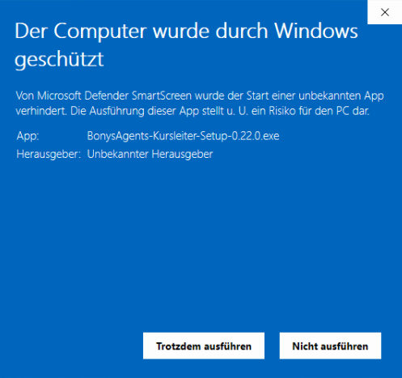{width=70%}

Danach findest du **„Bony's Agents“** im Startmenü.

## Linux (Debian, Ubuntu, Linux Mint)

1. Doppelklick auf `bonys-agents_<Version>_amd64.deb`.
2. Die Softwareverwaltung öffnet sich. Klicke auf **„Installieren“** und gib dein Passwort ein.
3. QEMU wird automatisch mitinstalliert.

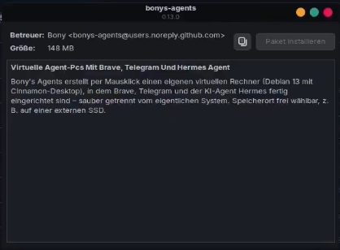{width=70%}

Das Paket richtet auch eine Paketquelle ein. Updates kommen deshalb später ganz normal über die
**Aktualisierungsverwaltung** deines Systems.

## macOS

**Welcher Chip steckt in meinem Mac?** Apple-Menü → „Über diesen Mac“. Steht dort „Chip Apple M…“, nimm die Datei
mit `applesilicon`. Steht dort „Prozessor Intel …“, nimm die Datei mit `intel`.

1. Öffne die `.dmg`-Datei und ziehe **„Bony's Agents“** auf **„Programme“**.
2. Öffne Bony's Agents im Ordner „Programme“. macOS meldet: *„Bony's Agents“ nicht geöffnet*. Klicke auf
   **„Fertig“** (nicht auf „In den Papierkorb legen“).
3. Öffne Apple-Menü → **Systemeinstellungen** → **Datenschutz & Sicherheit**. Scrolle ganz nach unten zu
   **„Sicherheit“**. Dort steht *„Bony's Agents“ wurde blockiert*. Klicke auf **„Dennoch öffnen“** und bestätige
   mit deinem Passwort oder Touch ID.
4. Öffne Bony's Agents noch einmal und wähle im Dialog **„Dennoch öffnen“**.

{width=55%}

{width=75%}

**Unter macOS 14 (Sonoma)** geht es kürzer: Im Ordner „Programme“ mit der rechten Maustaste auf Bony's Agents →
**„Öffnen“** → im Dialog noch einmal **„Öffnen“**.

::: hinweis
Meldet macOS *„ist beschädigt und kann nicht geöffnet werden“*, öffne das Programm **Terminal** und gib ein:
`xattr -cr "/Applications/Bony's Agents.app"` – danach startet die App normal. Diese Warnungen gibt es nur beim
allerersten Start.
:::

## Ist die Datei echt?

Auf der Releases-Seite liegt die Datei `SHA256SUMS`. Darin steht für jede Datei eine Prüfsumme. Wer sicher gehen
will, vergleicht sie, zum Beispiel unter Windows in PowerShell mit `Get-FileHash .\BonysAgents-Setup-<Version>.exe`.
Die Liste selbst ist digital signiert.

## Der erste Start

Beim ersten Start prüft Bony's Agents, ob alles da ist. Fehlt etwas, öffnet sich **„Rechner vorbereiten“**.

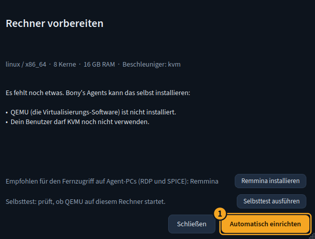{width=65%}

1. Klicke auf **„Automatisch einrichten“** ①. Bony's Agents installiert, was fehlt. Unter Linux fragt es einmal
   nach deinem Passwort, unter Windows nach deiner Zustimmung.
2. Unter macOS installiert es QEMU über Homebrew. Fehlt Homebrew, öffnet sich ein Terminal mit dem offiziellen
   Installer. Dort bestätigst du mit der Eingabetaste und deinem Passwort.
3. Unter Linux empfiehlt Bony's Agents zusätzlich **Remmina** für den Fernzugriff. Das ist freiwillig.

Danach fragt Bony's Agents, ob es **einmal am Tag nach Updates suchen** darf. Das ist deine Entscheidung.
Installiert wird nie ohne deine Zustimmung.

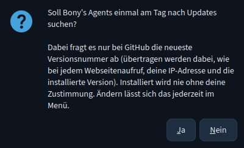{width=50%}

Später kannst du jederzeit über **„System prüfen“** oben im Fenster nachsehen, ob alles in Ordnung ist.

# Der erste Agent-PC

## Das Hauptfenster

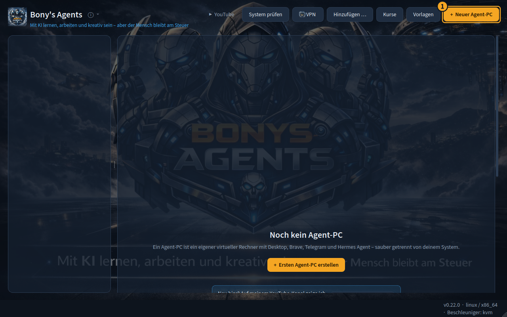

Am Anfang ist die Liste leer. Klicke auf **„+ Ersten Agent-PC erstellen“** oder oben rechts auf
**„+ Neuer Agent-PC“** ①.

Wenn du schon Agent-PCs hast, sieht das Fenster so aus:

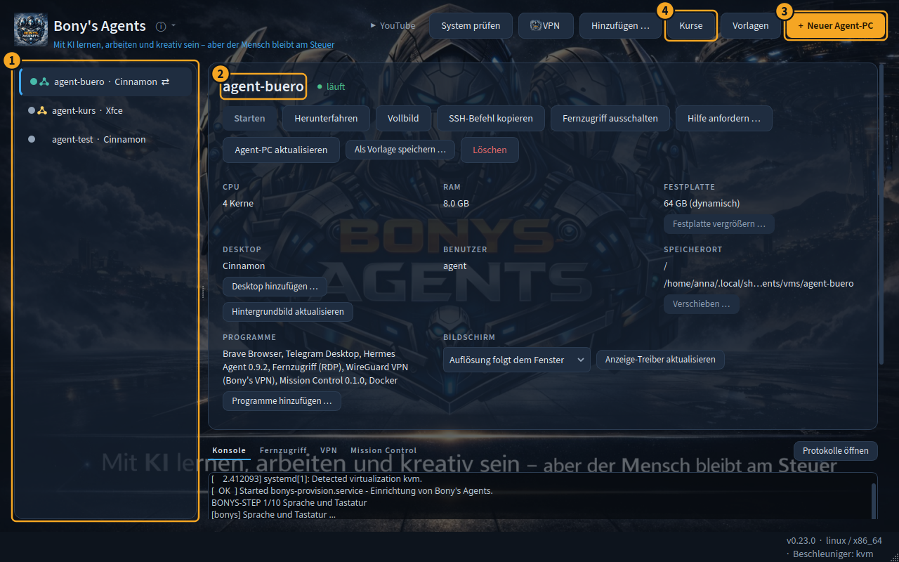

- ① **Liste** deiner Agent-PCs. Der Punkt zeigt den Zustand: grün = läuft, grau = aus, gelb = wird eingerichtet,
  rot = Einrichtung abgebrochen. Das kleine Netz-Symbol zeigt, ob der Agent-PC im Bony-Netz ist. Das ⇄ heißt:
  Fernzugriff ist an.
- ② **Detailansicht** des gewählten Agent-PCs mit allen Knöpfen.
- ③ **„+ Neuer Agent-PC“**.
- ④ **„Kurse“**: an einem Kurs teilnehmen.

Oben stehen außerdem **„System prüfen“**, **„VPN“** (nur unter Linux), **„Hinzufügen …“** (einen vorhandenen
Agent-PC von einer SSD aufnehmen) und **„Vorlagen“**. Das kleine **ⓘ** neben dem Namen öffnet das Menü:

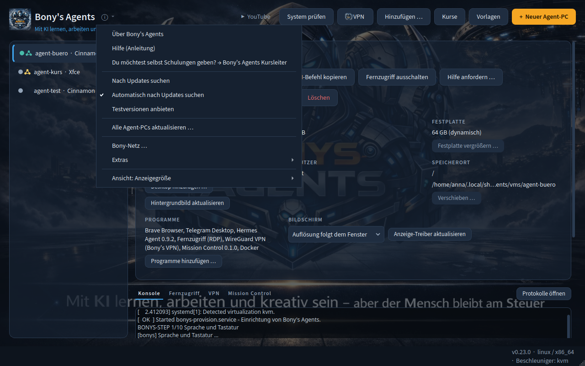

Dort findest du unter anderem „Über Bony's Agents“, diese Anleitung, die Update-Einstellungen, „Bony-Netz …“ und
unter „Ansicht“ die **Anzeigegröße** (größer oder kleiner, auch mit Strg + Plus und Strg + Minus).

## Einen Agent-PC erstellen

Klicke auf **„+ Neuer Agent-PC“**. Es öffnet sich dieses Fenster:

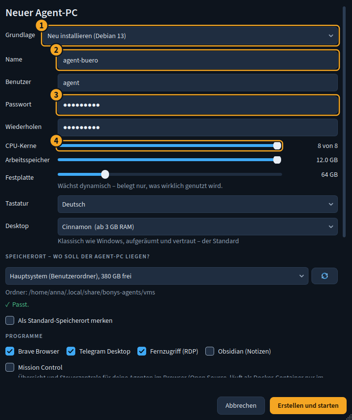{width=75%}

1. **Grundlage** ①: Lass „Neu installieren (Debian 13)“ stehen. (Wenn du später Vorlagen hast, kannst du hier
   eine auswählen – dann ist der Agent-PC in Sekunden fertig. Für Sicherheitskurse gibt es außerdem
   „Neu installieren (Kali Linux)“, siehe Kapitel „Kali Linux“.)
2. **Name** ②: zum Beispiel `agent-buero`. Erlaubt sind Buchstaben, Ziffern, Bindestrich und Unterstrich,
   höchstens 40 Zeichen, ohne Leerzeichen.
3. **Benutzer**: Lass `agent` stehen.
4. **Passwort** ③ und **Wiederholen**: Denk dir ein Passwort für den Agent-PC aus und schreib es dir auf. Du
   brauchst es selten, zum Beispiel für den Fernzugriff.
5. **CPU-Kerne, Arbeitsspeicher, Festplatte** ④: Bony's Agents schlägt passende Werte vor. Du musst nichts ändern.
   Die Festplatte wächst nur so weit, wie sie wirklich gefüllt wird.
6. **Desktop**: Cinnamon ist der Standard und sieht ähnlich aus wie Windows. Für schwache Rechner ist Xfce gut.

Scrolle im Fenster nach unten:

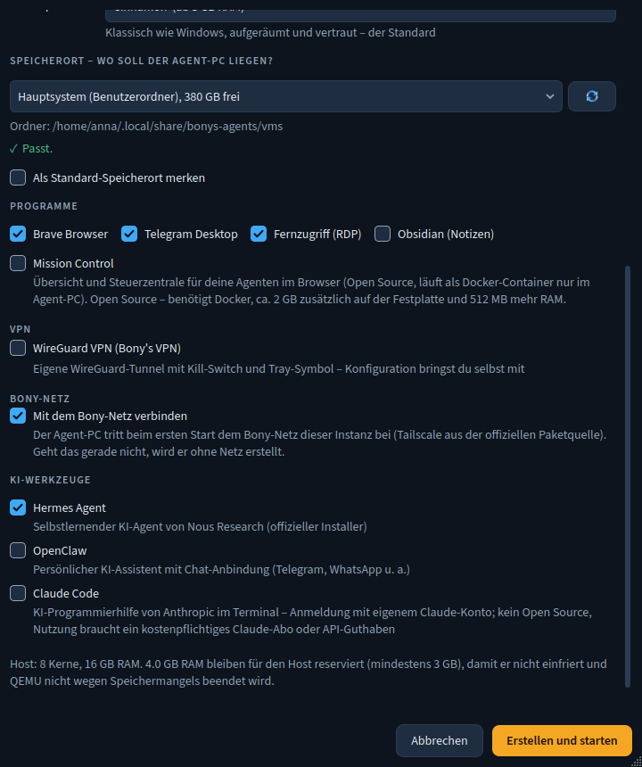{width=75%}

7. **Speicherort**: Wo der Agent-PC liegen soll. Normalerweise auf deinem Rechner. Du kannst auch eine externe
   SSD wählen.
8. **Programme**: Brave, Telegram, Fernzugriff (RDP), das **Software-Center**, die Liste **Agenten-Apps** und
   **n8n** sind schon angehakt. **Obsidian** (Notizen) und **Mission Control** kannst du zusätzlich wählen.
9. **VPN**: Nur wenn du einen eigenen WireGuard-Zugang hast (siehe Kapitel „VPN“).
10. **Bony-Netz**: Das Häkchen „Mit dem Bony-Netz verbinden“ erscheint nur, wenn du das Bony-Netz eingeschaltet
    hast. Für Kurse über das Internet muss es gesetzt sein (siehe Kapitel „Bony-Netz“).
11. **KI-Werkzeuge**: **Hermes Agent** ist angehakt. OpenClaw und Claude Code sind freiwillig.
12. Klicke auf **„Erstellen und starten“**.

## Warten, bis er eingerichtet ist

Beim allerersten Mal lädt Bony's Agents das Debian-System herunter (ungefähr 450 MB). Danach richtet sich der
Agent-PC **unsichtbar im Hintergrund** selbst ein. Das dauert je nach Rechner und Internet **15 bis 60 Minuten**.

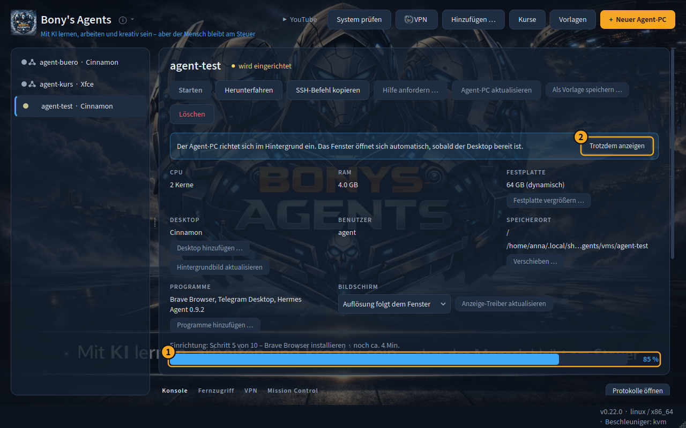

- ① Der Balken zeigt den Fortschritt, darüber steht der aktuelle Schritt und die geschätzte Restzeit.
- ② **„Trotzdem anzeigen“** zeigt die Konsole groß. Das brauchst du nur, wenn du neugierig bist oder etwas hängt.

Wenn alles fertig ist, schaltet sich der Agent-PC kurz aus und öffnet sich dann **von selbst im Fenster** mit dem
fertigen Desktop. Du kannst Bony's Agents in der Zwischenzeit schließen: Der Agent-PC startet dann beim nächsten
Öffnen der App.

::: hinweis
Wird die Einrichtung unterbrochen (Rechner neu gestartet, Fenster geschlossen, zu wenig Speicher), steht in der
Liste „Einrichtung abgebrochen“ mit der vermuteten Ursache. Klicke dann auf **„Einrichtung fortsetzen“** ①. Fertige
Schritte werden übersprungen.
:::

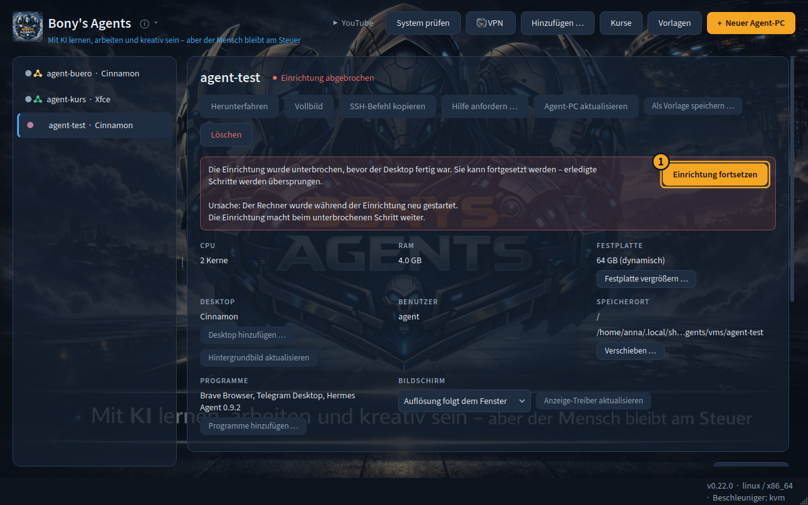

## Starten, Herunterfahren, Vollbild

In der Detailansicht findest du diese Knöpfe:

| Knopf | Was er tut |
|---|---|
| **Starten** | schaltet den Agent-PC ein, sein Fenster öffnet sich |
| **Herunterfahren** | fährt ihn sauber herunter – sofort, ohne Rückfrage im Agent-PC |
| **Sofort ausschalten** | erscheint, wenn das Herunterfahren hängt: wie Stecker ziehen |
| **Vollbild** | zeigt den Agent-PC über den ganzen Monitor – zurück mit **Strg + Alt + F** |
| **SSH-Befehl kopieren** | für Fortgeschrittene: Anmeldung im Terminal |
| **Agent-PC aktualisieren** | holt alle Updates für Debian und die Programme im Agent-PC |
| **Als Vorlage speichern …** | macht aus dem Agent-PC eine Vorlage (siehe Kapitel „Vorlagen“) |
| **Löschen** | löscht den Agent-PC mit allen Dateien darin |

Neben den Werten in der Detailansicht stehen kleine Knöpfe: **„Leistung ändern …“** beim Arbeitsspeicher (siehe
„Programme hängen oder ein Fenster geht nicht auf“ unter „Häufige Fragen“) und **„Festplatte vergrößern …“** bei
der Festplatte.

Die Bildschirmgröße des Agent-PCs folgt dem Fenster: Zieh einfach am Fensterrand. Falls das einmal nicht klappt,
kannst du unter **„Bildschirm“** eine feste Auflösung wählen. Das gilt ab dem nächsten Start.

::: warnung
**„Löschen“ lässt sich nicht rückgängig machen.** Alles im Agent-PC ist danach weg – auch Dateien, die die KI für
dich angelegt hat. Speichere Wichtiges vorher woanders.
:::

## Im Agent-PC

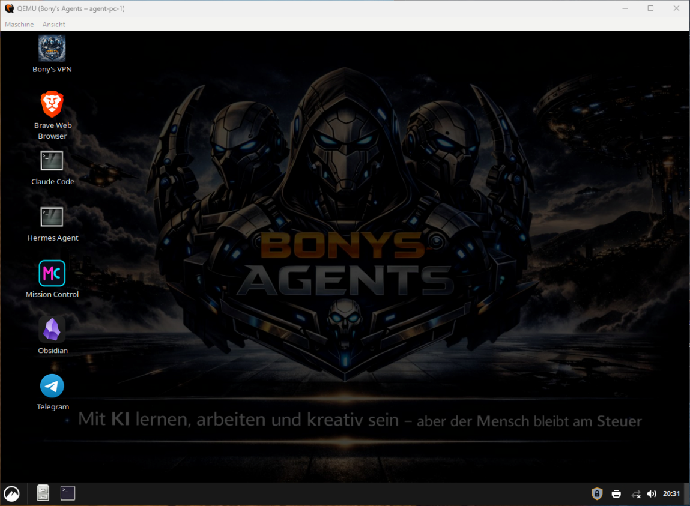

Im Agent-PC bist du **automatisch angemeldet**. Auf dem Schreibtisch liegen Symbole für **Brave**, **Telegram**
und **Hermes Agent**, dazu die Programme, die du bei der Einrichtung zusätzlich ausgewählt hast – im Bild etwa
Claude Code, Mission Control, Obsidian und Bony's VPN (beim Desktop GNOME stehen sie in der Leiste am linken Rand).
Ein Doppelklick startet das Programm.

- **Brave** ist ein Browser wie Chrome oder Firefox.
- **Telegram** ist ein Messenger. Du kannst dich mit deiner Telefonnummer anmelden – oder es weglassen.
- **Hermes Agent** öffnet ein Terminal-Fenster, in dem du mit Hermes schreibst.

Der Agent-PC ist auf Deutsch eingestellt, auch die Tastatur. Nach ein paar Minuten ohne Eingabe kommt ein
Bildschirmschoner. Er geht mit einem Tastendruck weg, ohne Passwort.

## Programme nachträglich hinzufügen

Dein Agent-PC muss dafür laufen. Klicke in der Detailansicht bei „Programme“ auf **„Programme hinzufügen …“**,
hake an, was du möchtest, und klicke auf „Installieren“.

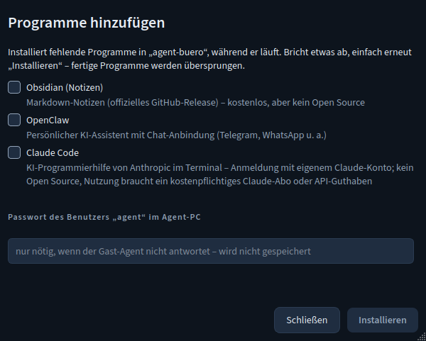{width=65%}

Genauso gibt es **„Desktop hinzufügen …“**, wenn du einen anderen Desktop ausprobieren möchtest. Der bisherige
bleibt installiert.

# Hermes einrichten

Beim ersten Start muss Hermes wissen, **welches KI-Modell** es benutzen soll. Ein Modell ist das „Gehirn“
hinter Hermes. Die Modelle laufen bei Anbietern im Internet. Dafür brauchst du dort ein Konto und einen
**API-Schlüssel** (eine Art Passwort für Programme).

## Der erste Start

1. Doppelklicke im Agent-PC auf **Hermes Agent**. Ein Terminal öffnet sich.
2. Gib ein: `hermes setup` und drücke die Eingabetaste.
3. Der Einrichtungs-Assistent fragt dich Schritt für Schritt: Anbieter wählen, API-Schlüssel einfügen, Modell
   wählen. Mit den Pfeiltasten wählst du aus, mit der Eingabetaste bestätigst du.
4. Am Ende kannst du optional einen Telegram-Bot verbinden. Das kannst du auch überspringen.
5. Prüfe die Installation mit `hermes doctor`.
6. Starte Hermes mit `hermes`. Jetzt kannst du ihm schreiben.

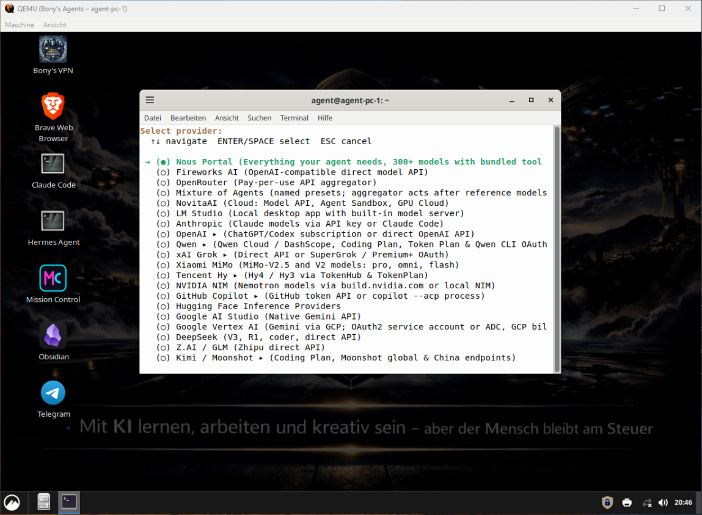

## Kostenlos anfangen

Der einfachste Weg: In `hermes setup` bei der Anbieter-Wahl den **obersten Punkt „Nous“** wählen und dort ein
**kostenloses (free) Modell**. Fragt Hermes nach einer Anmeldung, meldest du dich mit deinem **eigenen** Konto an –
nie mit einem fremden. So arbeiten auch die mitgelieferten Kurspakete.

Eine Alternative ist **OpenRouter**: Modelle mit dem Zusatz `:free` im Namen kosten nichts. Dafür brauchst du ein
kostenloses Konto bei openrouter.ai und dort einen eigenen API-Schlüssel.

Nützlich in Hermes: `hermes --tui` startet eine übersichtlichere Oberfläche, `/tools` zeigt die Werkzeuge, die
Hermes benutzen darf, `/help` alle Befehle, `/model` wechselt das Modell. Hermes braucht ein Modell mit mindestens
64K Kontext.

::: hinweis
Welche Modelle kostenlos sind und wie viele Anfragen gehen, ändern die Anbieter oft (Stand Oktober 2026: bei
OpenRouter etwa 50 Anfragen am Tag ohne Guthaben). Kostenlose Modelle sind außerdem manchmal langsam. Für ein paar Übungen reicht das. Wer viel mit Hermes arbeitet,
stößt schnell an die Grenze und lädt dann Guthaben auf oder wechselt den Anbieter.
:::

## Den Anbieter wechseln

Gib im Terminal `hermes model` ein. Dort wählst du einen anderen Anbieter oder ein anderes Modell, zum Beispiel
**Nous Portal** (Abo von Nous Research), **OpenRouter**, **OpenAI** oder einen eigenen Server. `hermes setup`
startet den ganzen Assistenten noch einmal.

Hermes aktualisiert sich mit `hermes update`. Einfacher ist **„Agent-PC aktualisieren“** in Bony's Agents: Das
aktualisiert alles auf einmal.

::: datenschutz
Was du Hermes schreibst, geht an den gewählten Anbieter. Gib keine Passwörter, Kontodaten oder Gesundheitsdaten
ein. Dein API-Schlüssel liegt nur im Agent-PC (`~/.hermes/.env`), nicht auf deinem Rechner.
:::

## OpenClaw und Claude Code

- **OpenClaw**: Symbol „OpenClaw“ öffnen. Beim ersten Mal startet die Einrichtung: Modell wählen, anmelden,
  optional einen Chat verbinden.
- **Claude Code**: Symbol „Claude Code“ öffnen. Es braucht ein **eigenes, bezahltes Claude-Konto**. Die Anmeldung
  läuft beim ersten Start im Browser. Claude Code ist kein Open Source.

# Weitere Funktionen

## Vorlagen

Eine **Vorlage** ist ein fertig eingerichteter Agent-PC zum Kopieren. Neue Agent-PCs aus einer Vorlage sind in
Sekunden fertig – ohne Download und ohne Einrichtung.

**Vorlage speichern:** Agent-PC herunterfahren → **„Als Vorlage speichern …“** → Name und Beschreibung eingeben →
**„Vorlage erstellen“**. Das Original bleibt unverändert.

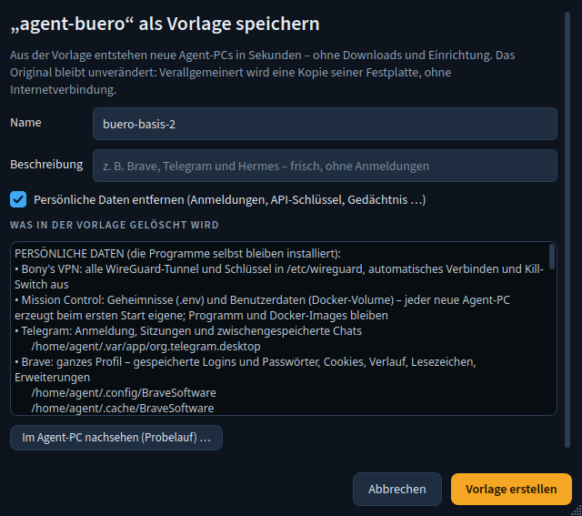{width=70%}

Das Häkchen **„Persönliche Daten entfernen“** ist voreingestellt. Es löscht Anmeldungen, API-Schlüssel, das
Gedächtnis von Hermes, Browser-Daten und eigene Dateien in der Vorlage. Die Programme bleiben installiert. Im
Kasten darunter steht genau, was gelöscht wird.

**Vorlage benutzen:** „+ Neuer Agent-PC“ → oben bei **„Grundlage“** die Vorlage wählen.

- **Schnell (verknüpft)**: sofort fertig, braucht kaum Platz. Die Vorlage muss auf demselben Laufwerk bleiben.
- **Unabhängig (vollständige Kopie)**: braucht mehr Platz, funktioniert aber ohne die Vorlage.

**Vorlagen verwalten:** Knopf **„Vorlagen“** oben im Hauptfenster. Dort kannst du umbenennen, die Beschreibung
ändern, löschen, weitergeben und importieren.

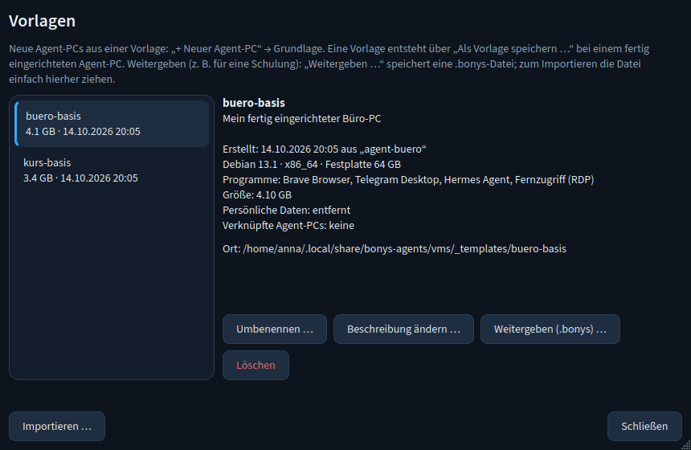

**Weitergeben (.bonys) …** speichert eine Vorlage als eine einzige Datei, zum Beispiel für einen Kurs. Vorher prüft
Bony's Agents in einer Kopie, dass keine Anmeldungen, Tokens oder Schlüssel mehr darin sind. Trag **Ersteller** ①
und **Version** ② ein und klicke auf **„Prüfen und exportieren“** ③. Wer die Datei bekommt, zieht sie einfach ins
Fenster „Vorlagen“ oder klickt auf **„Importieren …“**.

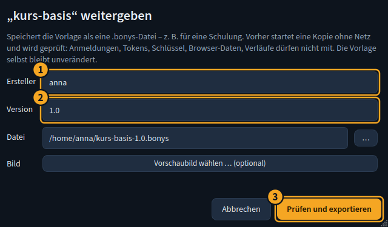{width=65%}

## Fernzugriff

Mit Fernzugriff erreichst du einen Agent-PC von einem anderen Gerät in deinem Heimnetz, zum Beispiel vom Laptop
oder Tablet.

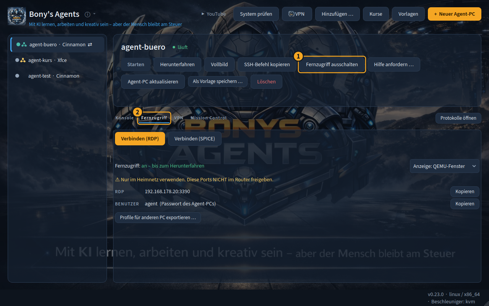

1. Klicke auf **„Fernzugriff einschalten“** ①. Du wählst, ob er **nur bis zum Herunterfahren** oder **dauerhaft**
   an bleiben soll.
2. Unten im Bereich **„Fernzugriff“** ② stehen Adresse, Port und Benutzer. **„Verbinden (RDP)“** öffnet die
   Verbindung, **„Profile für anderen PC exportieren …“** erzeugt fertige Dateien für andere Geräte.
3. Angemeldet wird mit dem Benutzer `agent` und dem Passwort des Agent-PCs.

::: warnung
Fernzugriff nur im **Heimnetz** benutzen. Gib diese Ports **nicht** im Router frei. Standardmäßig ist der
Fernzugriff aus.
:::

## Obsidian

**Obsidian** ist ein Programm für Notizen. Du kannst es beim Erstellen oder über „Programme hinzufügen …“
anhaken. Auf dem Schreibtisch des Agent-PCs liegt dann eine Verknüpfung, der leere Notiz-Ordner
`~/Agent-Notizen` ist schon geöffnet. Obsidian ist kostenlos, aber kein Open Source.

Einen gemeinsamen Ordner zwischen deinem Rechner und dem Agent-PC gibt es absichtlich nicht – die KI hätte sonst
Zugriff auf deine Dateien.

## Mission Control

**Mission Control** ist eine Übersicht und Steuerzentrale für deine Agenten im Browser. Es läuft nur im
Agent-PC (mit Docker) und braucht etwa 2 GB mehr Platz und 512 MB mehr Arbeitsspeicher.

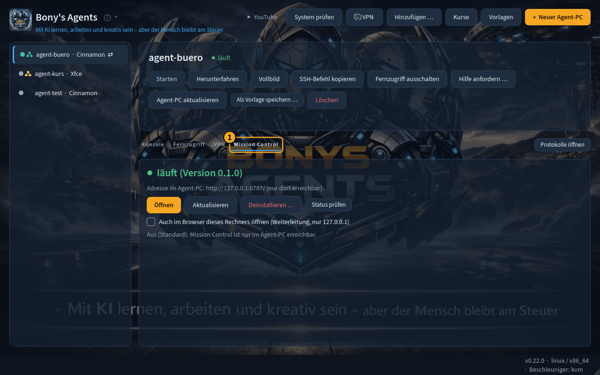

Im Bereich **„Mission Control“** ① siehst du, ob es läuft. **„Öffnen“** zeigt die Oberfläche im Agent-PC,
**„Aktualisieren“** holt die neueste Version. Die Weiterleitung an deinen eigenen Rechner ist aus und nur bei
Bedarf einzuschalten.

## Software-Center

Mit dem **Software-Center** installierst du weitere Programme per Klick – zum Beispiel das Bildprogramm GIMP oder
Inkscape. Öffne **„Software“** über das Startmenü oder den Schreibtisch, suche das Programm und klicke auf
**„Installieren“**. Die Programme kommen von **Flathub**, der offiziellen Sammelstelle für Linux-Programme; ein
Passwort brauchst du dafür nicht. Beim ersten Start lädt das Software-Center einmal die Liste aller Programme,
das dauert eine Minute.

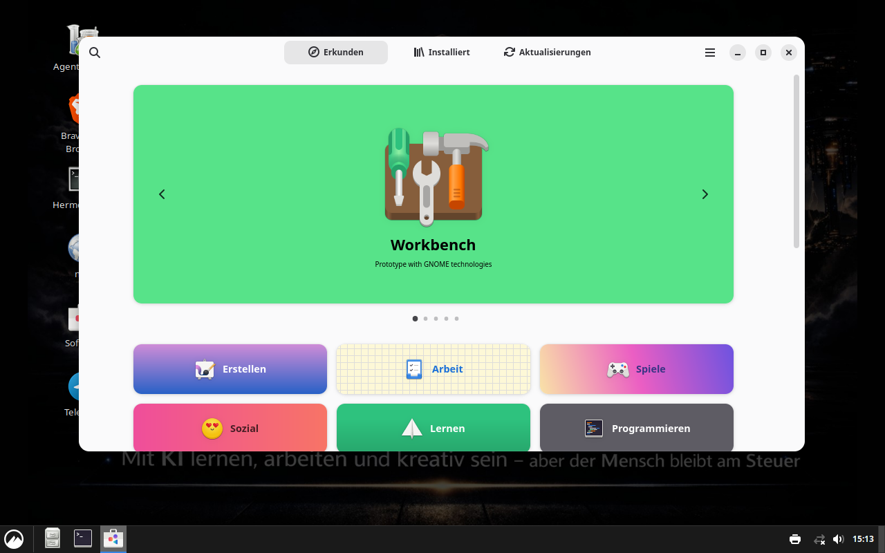{width=75%}

## Tor Browser

Der **Tor Browser** (standardmäßig aus, beim Erstellen oder über „Programme hinzufügen …“) leitet deine
Verbindungen über das **Tor-Netz**. Webseiten sehen dann nicht deine IP-Adresse, sondern die eines Tor-Rechners
irgendwo auf der Welt. Beim ersten Start lädt er den offiziellen Tor Browser von torproject.org herunter und prüft
dessen Signatur – das dauert eine Minute. Danach klickst du auf **„Verbinden“**.

Zusammen mit dem Agent-PC heißt das: Was du im Tor Browser machst, bleibt im Agent-PC und berührt deinen eigenen
Rechner nicht. **Ganz anonym bist du damit trotzdem nicht** – der Agent-PC läuft auf deinem Rechner, und wer sich
mit Namen anmeldet, ist erkennbar. Der Tor Browser weist selbst darauf hin, dass einige seiner Schutzfunktionen
auf diesem System schwächer sein können. Für echte Anonymität empfiehlt das Tor Project Tails auf einem
USB-Stick.

::: hinweis
Den Tor Browser gibt es für Linux nur auf **x86_64**. Auf einem Mac mit Apple-Chip steht er deshalb nicht zur
Auswahl.
:::

Updates holt das Software-Center nicht selbst – das macht **„Agent-PC aktualisieren“** in Bony's Agents.

## Kali Linux

Statt Debian 13 kann ein Agent-PC auch **Kali Linux** als Grundsystem haben – die bekannte Linux-Sammlung für
Sicherheitstests. Wähle dafür beim Erstellen unter **Grundlage** „Neu installieren (Kali Linux)“. Bony's Agents lädt
dann das offizielle Kali-Abbild von kali.download, prüft seine Prüfsumme und richtet es genauso ein wie sonst:
Sprache, Desktop, Brave, Hermes und die anderen Programme.

Dazu kommen die **Kali-Werkzeuge** (schon angehakt): die zehn bekanntesten, darunter **nmap**, **Metasploit**,
**Burp Suite**, **Wireshark**, **John the Ripper**, **Hydra** und **sqlmap**. Du findest sie im Startmenü oben
links unter den Kali-Kategorien. Wireshark darf ohne Administrator-Passwort mitschneiden.

Damit lernst du im Agent-PC, wie Angriffe funktionieren – getrennt von deinem eigenen Rechner. Für Kurse ist das
ideal: Jeder Teilnehmer hat sein eigenes Kali, und nach einer Übung setzt du es mit einem Startzustand zurück.

::: warnung
Setze die Kali-Werkzeuge **nur gegen eigene Rechner oder solche ein, für die du eine ausdrückliche Erlaubnis
hast**. Fremde Systeme ohne Erlaubnis anzugreifen, ist strafbar – auch „nur zum Ausprobieren“.
:::

Gut zu wissen:

- Kali gibt es als Agent-PC nur auf **x86_64** und nur mit dem Desktop **Xfce** (so geprüft). Auf einem Mac mit
  Apple-Chip steht es nicht zur Auswahl.
- Gib dem Agent-PC mindestens **6 GB Arbeitsspeicher**, wenn du Metasploit und Burp Suite gleichzeitig nutzt.
- Die Einrichtung dauert etwas länger als bei Debian: Am Ende stellt Bony's Agents Kali auf den normalen Kernel mit
  Grafiktreibern um (das Cloud-Abbild bringt einen Kernel ohne Grafik mit).
- Kali veröffentlicht für seine Cloud-Abbilder nur Prüfsummen und keine Signatur. Bony's Agents lädt deshalb nur
  über eine verschlüsselte Verbindung direkt von kali.download.

## n8n

**n8n** baut Abläufe („Workflows“) per Klick zusammen: Mails abrufen, RSS-Feeds lesen, Telegram-Nachrichten
schicken, Dateien bearbeiten, Webseiten und Dienste abfragen. Es ist beim Erstellen angehakt und lässt sich über
„Programme hinzufügen …“ nachrüsten.

- n8n läuft im Agent-PC in **Docker** und ist **nur im Agent-PC selbst** erreichbar (`http://localhost:5678`) –
  weder in deinem Heimnetz noch im Bony-Netz.
- Doppelklick auf **„n8n“** auf dem Schreibtisch öffnet es in Brave. Beim ersten Öffnen legst du ein Konto an
  („Set up owner account“, die Oberfläche ist englisch). Das Konto gilt nur für dieses n8n und bleibt im
  Agent-PC; nach einem Neustart braucht n8n etwa eine Minute, bis die Seite erscheint.
- Deine Workflows liegen in einem eigenen Speicher (Docker-Volume `n8n_data`) und überstehen jedes Update.
- n8n braucht etwa **1 GB mehr Arbeitsspeicher**. Ist der Agent-PC zu knapp eingestellt, warnt das Fenster
  „Neuer Agent-PC“ und schlägt einen besseren Wert vor.

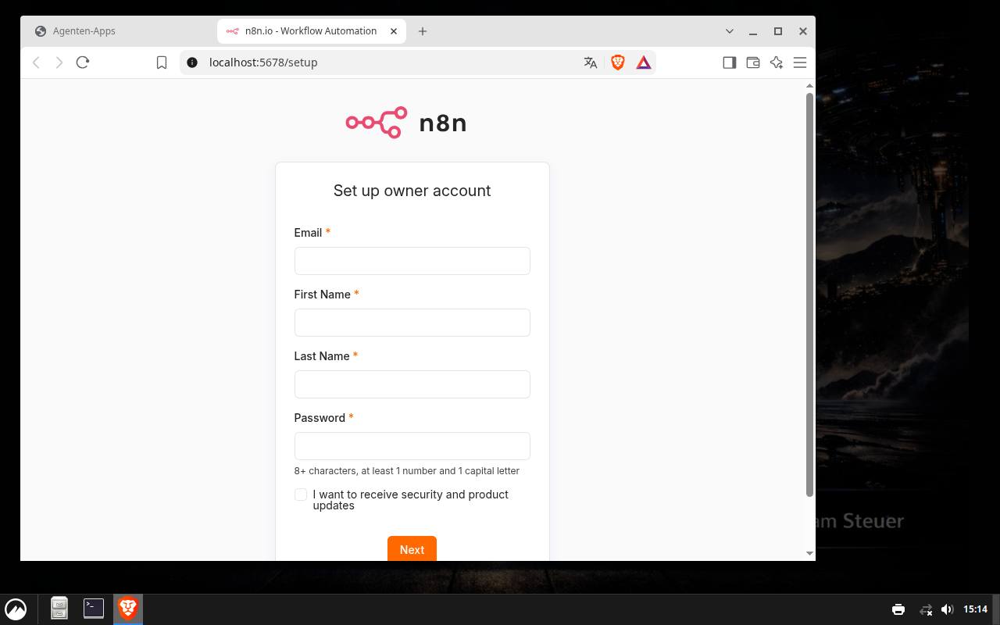{width=75%}

::: hinweis
**Lizenz:** n8n steht unter der **Sustainable Use License**. Der Quellcode ist offen und du darfst n8n für dich
kostenlos nutzen – es ist aber keine Open-Source-Lizenz im Sinne der OSI. Deshalb steckt n8n nicht in
weitergegebenen Vorlagen: Wer deine Vorlage öffnet, lädt n8n selbst aus der offiziellen Quelle.
:::

### n8n und Hermes zusammen

So arbeiten die beiden laut der Dokumentation von n8n und Hermes zusammen:

1. **Hermes stößt einen Workflow an (Webhook).** Beginne den Workflow in n8n mit dem Knoten **„Webhook“** und
   veröffentliche ihn. Die Adresse zeigt der Knoten an („Production URL“). Sag Hermes zum Beispiel:
   „Rufe diese Adresse mit curl per POST auf und schicke dabei den Text …“. Antworten kann der Workflow mit dem
   Knoten „Respond to Webhook“.
2. **Hermes bedient n8n über MCP.** In n8n unter **Einstellungen → Instance-level MCP** den Zugang einschalten,
   die gewünschten Workflows freigeben und unter „Connect a client“ einen Zugangsschlüssel (Token) erzeugen. Dann
   in `~/.hermes/config.yaml` eintragen:

   ```yaml
   mcp_servers:
     n8n:
       url: "http://localhost:5678/mcp-server/http"
       headers:
         Authorization: "Bearer DEIN-TOKEN"
   ```

   Danach kann Hermes Workflows suchen und ausführen. Der Token ist ein Passwort – er bleibt im Agent-PC.
3. **n8n gibt Hermes Aufgaben.** Hermes hat einen eigenen API-Server (nur `127.0.0.1:8642`, mit Schlüssel
   `API_SERVER_KEY` in `~/.hermes/.env`, gestartet mit `hermes gateway`). Ein Knoten **„HTTP Request“** in n8n
   schickt dann eine Aufgabe an den Endpunkt `/v1/chat/completions`. Aber: n8n läuft in Docker, und dort meint
   `127.0.0.1` den Container selbst. Der API-Server muss dafür auf einer Adresse lauschen, die der Container
   erreicht (`API_SERVER_HOST`) – das ist etwas für Fortgeschrittene.

## Agenten-Apps

Auf dem Schreibtisch jedes neuen Agent-PCs liegt **„Agenten-Apps“**: eine Liste bekannter Programme, die einen
**MCP-Server** haben – Hermes kann sie dann selbst bedienen. Dabei sind zum Beispiel PdfCraft (PDFs), PhotoCraft
(Bilder), WordCraft, GridCraft und DeckCraft (Texte, Tabellen, Präsentationen im Format von Word, Excel und
PowerPoint), CADCraft und SolidCraft (Konstruktion) sowie die offiziellen MCP-Server für Dateien und Git und
Playwright, mit dem Hermes einen Browser steuert.

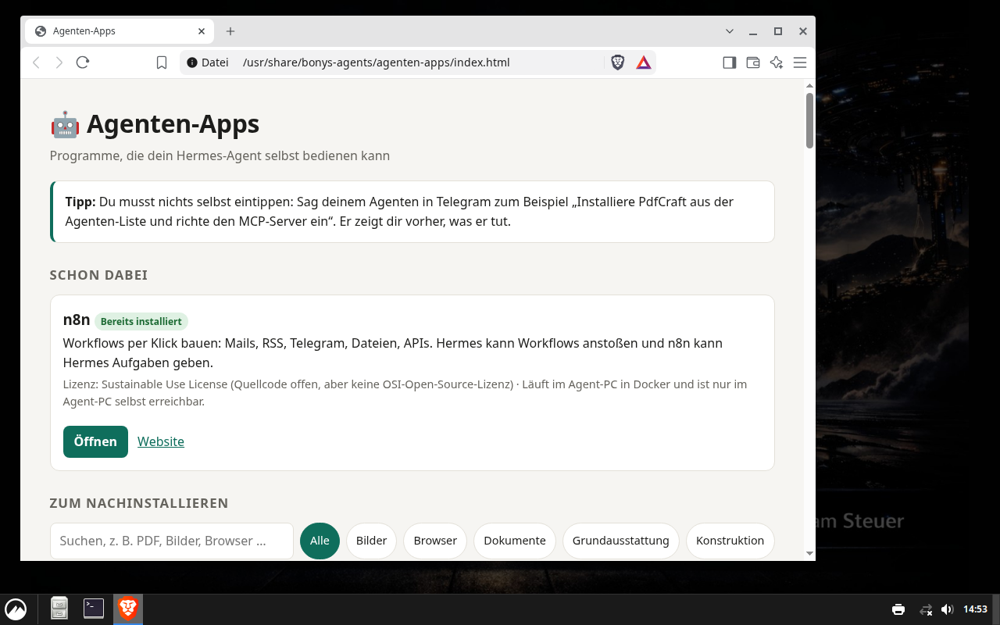{width=75%}

Bony's Agents installiert diese Programme **nicht** von selbst – du entscheidest. Jeder Eintrag zeigt unter
**„Installieren & mit Hermes verbinden“** die Befehle zum Kopieren:

1. Die offizielle Quelle (Download-Seite des Herstellers).
2. Die Befehle für das Terminal – sie laden die neueste Version von der offiziellen Seite und prüfen die
   Prüfsumme.
3. Den Befehl, der den MCP-Server bei Hermes anmeldet (`hermes mcp add …`).

Du musst nichts selbst eintippen: Sag Hermes zum Beispiel „Installiere PdfCraft aus der Agenten-Liste und richte
den MCP-Server ein“. Er zeigt dir vorher, was er tun will. Dateien für die Agenten gehören in den Ordner
`~/Agent-Dateien`. Die Liste funktioniert ohne Internet; die neueste Fassung steht immer online unter
<https://zappotex.github.io/BonysAgents/agenten-apps/>.

Viele dieser Programme sind noch jung (Alpha). Für wichtige Dateien vorher eine Kopie anlegen.

## VPN

Mit **Bony's VPN** geht der Internetverkehr eines Agent-PCs durch deinen eigenen **WireGuard-Tunnel**, zum Beispiel
zu deiner Fritzbox. Die Zugangsdatei (`.conf`) bringst du selbst mit.

- Beim Erstellen: unter **„VPN“** → „WireGuard VPN (Bony's VPN)“ anhaken und die Datei wählen.
- Im laufenden Agent-PC: Bereich **„VPN“** ① in der Detailansicht – verbinden, trennen, Status, Kill-Switch.

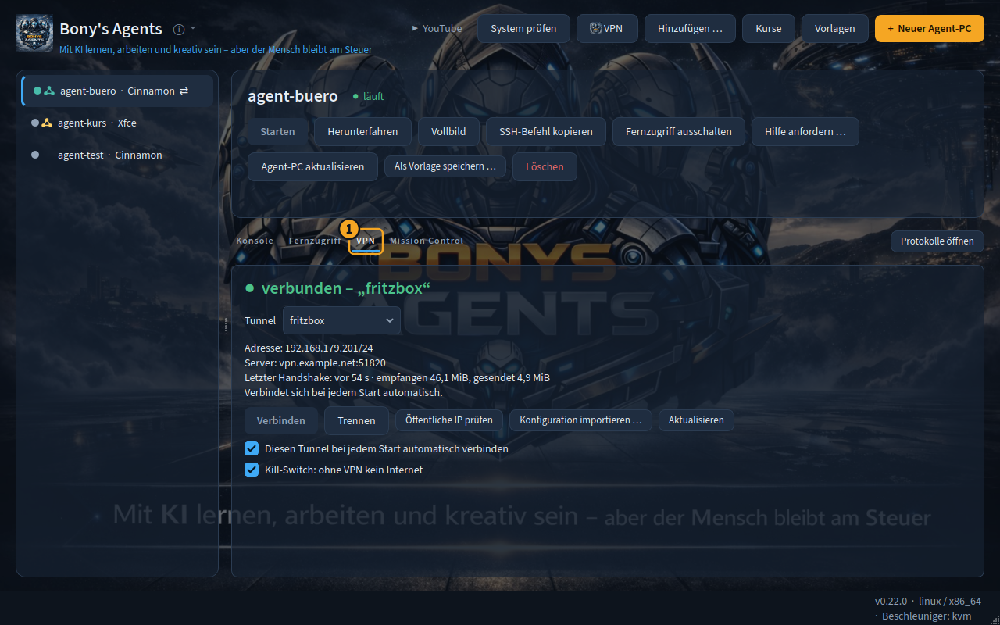

Der **Kill-Switch** sorgt dafür, dass der Agent-PC ohne Tunnel gar nicht ins Internet kommt.

Für **deinen eigenen Rechner** gibt es unter Linux den Knopf **„VPN“** oben im Fenster. Unter Windows und macOS
findest du im Menü **ⓘ → Extras** den Weg zur offiziellen WireGuard-App.

# Bony-Netz

## Was ist das Bony-Netz?

Das **Bony-Netz** ist ein privates Netz über das Internet. Darüber kann eine Kursleiterin oder ein Kursleiter
während eines Kurses deinen Agent-PC erreichen – egal, wo du gerade sitzt. Du brauchst es nur für **Kurse über das
Internet**.

Das Bony-Netz ist **standardmäßig aus**. Solange es aus ist, nimmt Bony's Agents keinen Kontakt zu einem
Bony-Netz-Server auf.

::: datenschutz
Eingeschaltet erfährt der Server: deine Instanz (eine zufällige Kennung, kein Name), die Namen deiner Agent-PCs im
Netz, ihre Netzadressen und ob sie online sind. Bei Kursen dazu den Kursnamen und die Anzeigenamen. Deinen eigenen
Rechner erreicht dabei niemand – nur die Agent-PCs, die du dafür auswählst.
:::

## Einschalten

1. Öffne das Menü **ⓘ → „Bony-Netz …“**.
2. Setze das Häkchen **„Bony-Netz verwenden“** ①.
3. Im Feld **Server** ② steht schon der Vorschlag. Wenn dir dein Kurs einen anderen Server nennt, trage ihn ein
   und klicke auf **„Prüfen“**.
4. Klicke auf **„Instanz anlegen“** ③. Eine **Instanz** ist deine Anmeldung beim Server. Du brauchst dafür keine
   E-Mail-Adresse und kein Passwort.

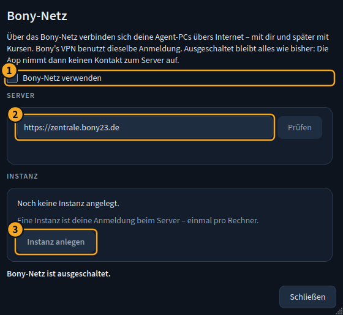{width=60%}

Danach sieht das Fenster so aus:

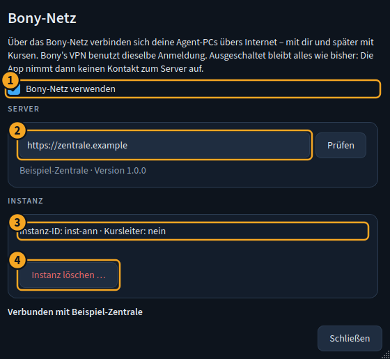{width=60%}

- ① Bony-Netz ist eingeschaltet.
- ② Der Server und darunter, ob er antwortet.
- ③ Die Kennung deiner Instanz.
- ④ **„Instanz löschen …“** löscht deine Instanz auf dem Server – mit deinen Agent-PCs im Netz, deinen Kursen und
  Teilnahmen – und meldet dich ab.

::: hinweis
Hast du auch **Bony's VPN** auf deinem Rechner, benutzen beide dieselbe Anmeldung. Was du hier einstellst, gilt
dort auch.
:::

## Agent-PCs ins Bony-Netz bringen

- **Neuer Agent-PC:** Im Fenster „Neuer Agent-PC“ ist das Häkchen **„Mit dem Bony-Netz verbinden“**
  voreingestellt, sobald das Bony-Netz an ist. Der Agent-PC tritt dann bei der Einrichtung dem Netz bei.
- **Vorhandener Agent-PC:** Starte ihn, klicke in der Liste mit der **rechten Maustaste** darauf und wähle
  **„Mit dem Bony-Netz verbinden“**.

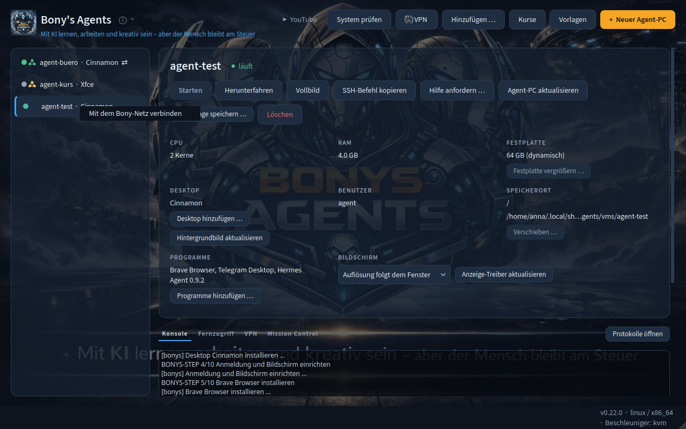

In der Liste zeigt ein kleines **Netz-Symbol** vor dem Namen den Zustand: grün = im Netz, gelb = offline (der
Agent-PC ist aus), grau = nicht verbunden.

## Eigener Server

Wer selbst einen Bony-Netz-Server betreibt (zum Beispiel ein Verein oder eine Schule), trägt dessen Adresse im
Fenster „Bony-Netz“ ins Feld **Server** ein und klickt auf **„Prüfen“**. Beim Wechsel des Servers wird die
Anmeldung beim alten Server verworfen; du legst beim neuen eine neue Instanz an.

# Kurspakete – Schritt für Schritt lernen

Ein **Kurspaket** ist ein fertiger Lerninhalt: Lektionen mit Anleitung, kleine Prüfaufgaben, ein Quiz und ein
Handout zum Ausdrucken. Du kannst ein Kurspaket **allein** durcharbeiten (Selbstlern-Modus) – oder es kommt in einem
**Kurs** von deiner Kursleitung. Ein Kurs ist die Veranstaltung, das Kurspaket ihr Inhalt.

## Die Bibliothek

Klicke im Hauptfenster auf **„Kurse“**. Der erste Reiter **„Kurspakete“** zeigt alle Kurspakete auf deinem Rechner
mit Stufe (Anfänger, Fortgeschritten, Experte), Dauer und deinem Fortschritt.

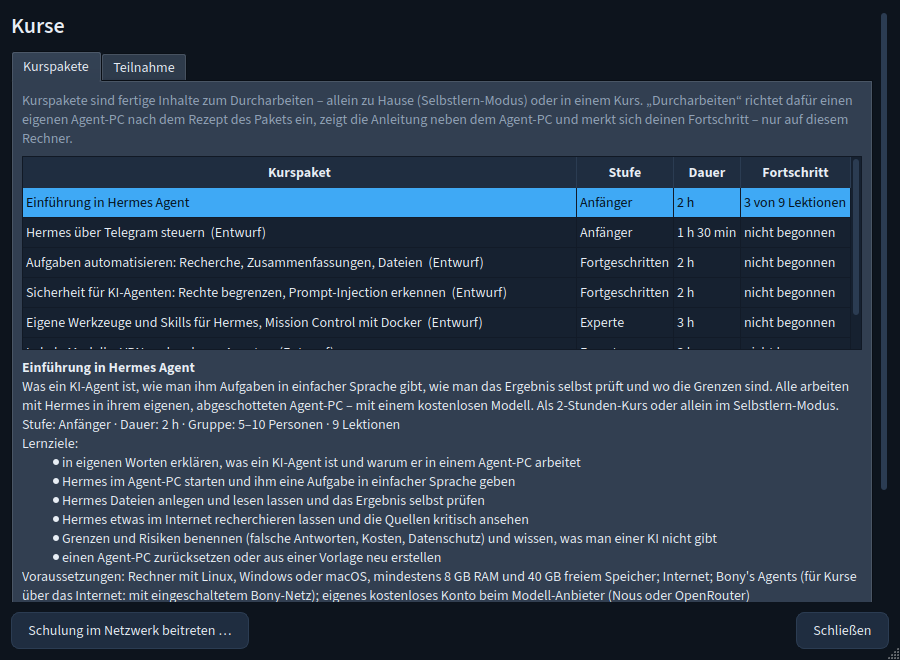{width=80%}

- **Mitgeliefert** sind „Einführung in Hermes Agent“ (fertig) und fünf **Entwürfe** – Gliederungen für weitere
  Kurspakete von „Hermes über Telegram steuern“ bis „Lokale Modelle, VPN und mehrere Agenten“.
- **„Importieren …“** übernimmt eine `.bonyspaket`-Datei, die du bekommen hast. Du kannst sie auch einfach auf das
  Fenster ziehen.
- **„Aus dem Internet …“** zeigt die Kurspakete aus der offenen Bibliothek von Bony's Agents. Bony's Agents lädt
  nur über HTTPS und prüft jede Datei, bevor sie in die Bibliothek kommt.
- **„Exportieren …“** speichert ein Kurspaket als Datei zum Weitergeben.

## Durcharbeiten

1. Kurspaket wählen → **„Durcharbeiten“**.
2. Bony's Agents schlägt einen **eigenen Agent-PC** für das Kurspaket vor (mit den Programmen, die es braucht) – oder
   du wählst einen vorhandenen. Ein eigener Agent-PC ist besser: Beim Üben geht dann nichts an deinen anderen
   Agent-PCs kaputt.
3. Neben dem Agent-PC öffnet sich das Fenster **„Anleitung“**. Es bleibt über allen Fenstern am rechten Rand, damit
   du lesen und gleichzeitig im Agent-PC arbeiten kannst („Immer im Vordergrund“ lässt sich abschalten).

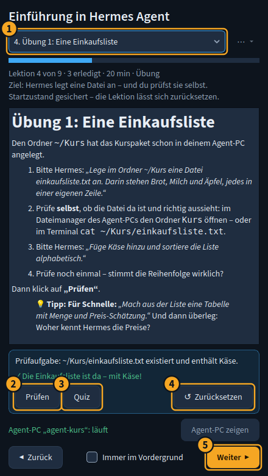{width=45%}

Im Fenster „Anleitung“:

- Oben ① springst du direkt zu einer Lektion; **„Weiter“** ⑤ und **„Zurück“** blättern.
- **„Prüfen“** ② schaut im Agent-PC nach, ob du die Aufgabe geschafft hast, zum Beispiel ob eine Datei da ist. Du
  siehst nur **„geschafft“** oder **„noch nicht“** mit einem Tipp.
- **„Quiz“** ③ stellt ein paar Fragen zur Lektion. Das Ergebnis bleibt auf deinem Rechner.
- **„↺ Zurücksetzen“** ④ setzt den Agent-PC auf den Stand vom Beginn der Lektion zurück. Bony's Agents sichert diesen
  Stand von selbst, sobald du eine Lektion zum ersten Mal betrittst. Alles, was du danach im Agent-PC geändert hast,
  geht dabei verloren – Bony's Agents fragt vorher.
- **„Agent-PC zeigen“** holt den Agent-PC nach vorn bzw. startet ihn.
- Unter **„⋯“** findest du das Handout, „Startzustände löschen …“ (gibt Speicher frei) und „Fortschritt
  zurücksetzen …“.

::: hinweis
Manche Kurspakete richten zu Beginn einer Lektion etwas im Agent-PC ein, zum Beispiel einen Übungsordner, und prüfen
deine Aufgaben mit kleinen Skripten. Diese Skripte laufen **nur im Agent-PC**, nie auf deinem Rechner. Bei
Kurspaketen, die nicht von Bony's Agents geprüft sind, siehst du vorher die Liste der Skripte und entscheidest
selbst.
:::

::: datenschutz
Im Selbstlern-Modus bleibt alles auf deinem Rechner: Fortschritt, Prüfergebnisse und Quiz. In einem Kurs sieht die
Kursleitung nur, **in welcher Lektion** du bist und ob die **Prüfaufgabe geschafft** ist – nie deine Dateien und nie
deine Antworten im Quiz.
:::

# An einem Kurs teilnehmen

## Zwei Arten von Kursen

| | Kurs über das Internet | Schulung im eigenen Netz |
|---|---|---|
| Wo? | jeder bei sich zu Hause | alle im selben Raum oder VPN |
| Was brauche ich? | Bony-Netz, Instanz, Agent-PC im Bony-Netz | nur Bony's Agents |
| Code | **Kurscode**, z. B. `K7QX-M3PA` | **Freigabe-Code**, z. B. `4711-BONY` |
| Bild und Ton | **Kursraum** mit Bildschirm, Ton, Kamera, Chat | Vorführung im Browser, ohne Ton |

Deine Kursleitung sagt dir, welche Art es ist. Die meisten Abschnitte unten gelten für Kurse über das Internet.
Die Schulung im eigenen Netz steht am Ende des Kapitels.

## Vorbereitung

Erledige das am besten **ein paar Tage vor dem Kurs**:

1. Bony's Agents installieren (Kapitel „Installation“).
2. Bony-Netz einschalten und eine Instanz anlegen (Kapitel „Bony-Netz“).
3. Einen Agent-PC erstellen, mit Häkchen **„Mit dem Bony-Netz verbinden“**. Warte, bis er fertig eingerichtet ist.
4. Hermes einrichten (Kapitel „Hermes einrichten“), wenn die Kursleitung das wünscht.

## Dem Kurs beitreten

1. Klicke im Hauptfenster auf **„Kurse“**. Der Reiter **„Teilnahme“** öffnet sich.
2. Gib den **Kurscode** ① ein. Groß- und Kleinschreibung und der Bindestrich sind egal.
3. Wähle den **Agent-PC** ②, mit dem du teilnimmst. Nur dieser eine Agent-PC ist für die Kursleitung erreichbar,
   und nur solange der Kurs läuft.
4. Gib **deinen Namen** ③ ein, so wie die anderen dich sehen sollen.
5. Klicke auf **„Beitreten“** ④.

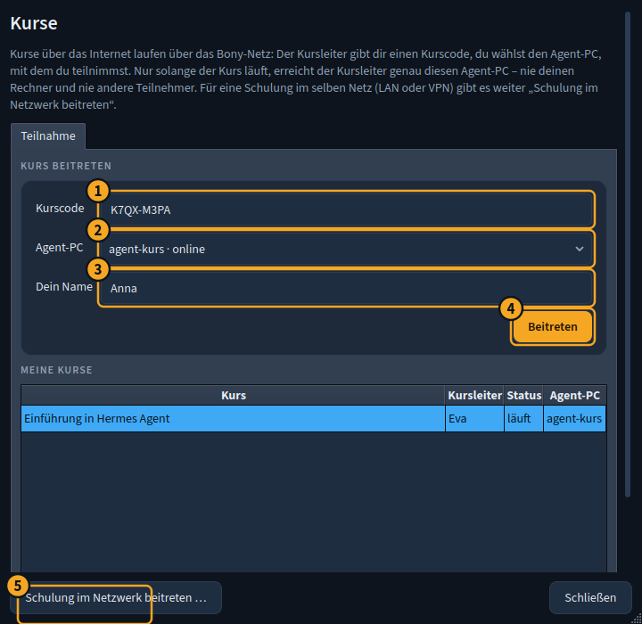{width=75%}

Der Kurs steht dann unter **„Meine Kurse“** mit Kursleitung und Status (offen, läuft, pausiert). Unten links ⑤ ist
der Weg zur Schulung im eigenen Netz.

Wenn ein Kurs beginnt, meldet Bony's Agents das unten in der Statuszeile ①:

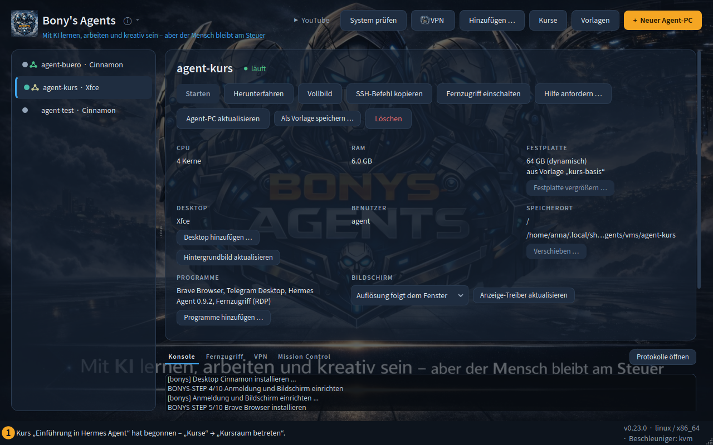

::: hinweis
Steht da *„Das Bony-Netz ist ausgeschaltet oder es ist noch keine Instanz angelegt“*, fehlt Schritt 2 der
Vorbereitung. Der Knopf **„Bony-Netz …“** im Hinweis führt direkt dorthin. Steht bei „Agent-PC“ nichts zur Auswahl,
ist noch keiner deiner Agent-PCs im Bony-Netz.
:::

**„Kurs verlassen …“** beendet deine Teilnahme. Danach erreicht die Kursleitung deinen Agent-PC über diesen Kurs
nicht mehr.

## Kurs mit Kurspaket

Hat die Kursleitung ein Kurspaket gewählt, steht es in „Meine Kurse“ in der Spalte **„Kurspaket“**. Bony's Agents
holt es von selbst in deine Bibliothek. Mit **„Anleitung“** öffnest du es neben dem Agent-PC, mit dem du am Kurs
teilnimmst – wie beim Durcharbeiten (Kapitel „Kurspakete“). Die Kursleitung sieht dabei in ihrer Kursansicht nur
deine **Lektion** und ob die **Prüfaufgabe geschafft** ist, und nur solange der Kurs läuft. Das Kurspaket
bleibt nach dem Kurs in deiner Bibliothek.

## Der Kursraum

Sobald der Kurs läuft: **„Kurse“** → Kurs in „Meine Kurse“ wählen → **„Kursraum betreten“**. Der Kursraum ist ein
eigenes Fenster.

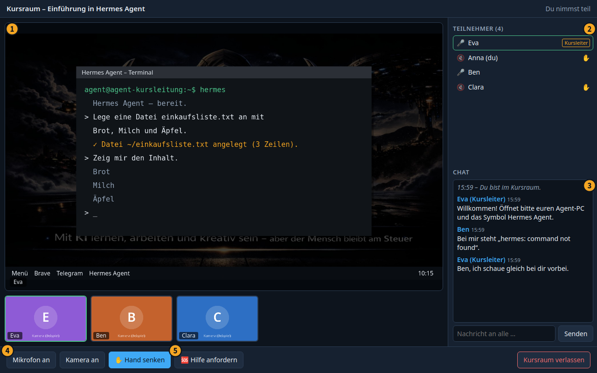

- ① **Bühne:** groß der Bildschirm, den die Kursleitung teilt (ohne Freigabe ihre Kamera). Darunter die
  eingeschalteten Kameras. Wer gerade spricht, ist grün umrandet.
- ② **Teilnehmer:** alle im Raum, mit 🎤 (Mikrofon an) oder 🔇 (aus) und ✋ bei erhobener Hand.
- ③ **Chat:** Nachrichten an alle. Der Chat wird nirgends gespeichert und ist weg, wenn du das Fenster schließt.
- ④ **Mikrofon und Kamera:** Du kommst mit **Mikrofon und Kamera aus** herein und schaltest sie selbst ein.
- ⑤ **„🆘 Hilfe anfordern“:** bittet die Kursleitung um Hilfe (siehe unten).

Mit **„✋ Hand heben“** meldest du dich, mit „✋ Hand senken“ nimmst du die Hand wieder herunter.
**„Kursraum verlassen“** rechts unten geht hinaus.

Hat die Kursleitung **„Sprechen nur nach Freigabe“** eingeschaltet, kannst du dein Mikrofon erst einschalten,
wenn sie es dir erlaubt. Heb dafür die Hand.

::: hinweis
**macOS** fragt beim ersten Mal, ob Bony's Agents Kamera und Mikrofon benutzen darf – bitte erlauben. Hast du aus
Versehen abgelehnt: Systemeinstellungen → Datenschutz & Sicherheit → Kamera bzw. Mikrofon → Bony's Agents
einschalten.
:::

Bricht die Verbindung kurz ab, steht oben „Verbindung wird wiederhergestellt …“. Ist der Kurs pausiert oder
beendet, erscheint eine Meldung mit **„Erneut eintreten“**:

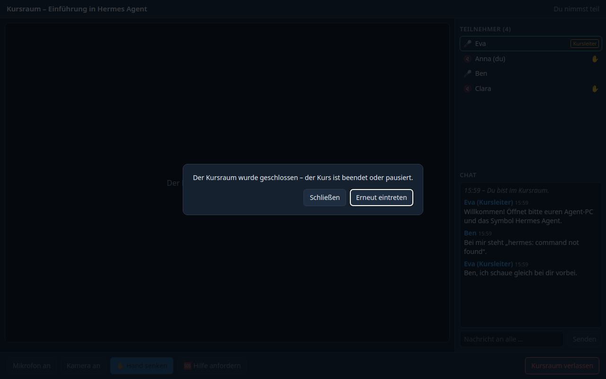{width=80%}

## Hilfe von der Kursleitung

Hängst du fest, kann die Kursleitung **deinen Agent-PC ansehen** und dir zeigen, was zu tun ist – aber **nur, wenn
du zustimmst. Jedes Mal neu.**

1. Klicke im Kursraum auf **„🆘 Hilfe anfordern“**. Die Kursleitung sieht dann ein 🆘 neben deinem Namen. Du
   kannst die Bitte mit „🆘 Bitte zurückziehen“ wieder zurücknehmen.
2. Klickt die Kursleitung bei dir auf **„Helfen“**, erscheint bei dir diese Frage:

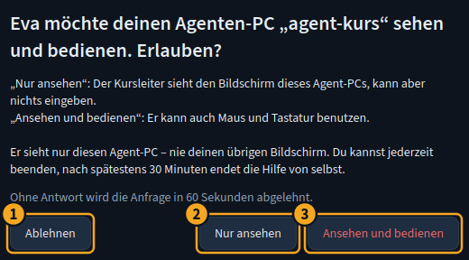{width=65%}

Du hast drei Möglichkeiten:

- ① **„Ablehnen“**: Die Kursleitung sieht nichts. Das ist auch die Wirkung von Eingabetaste, Esc und Schließen.
  Antwortest du 60 Sekunden lang nicht, gilt die Anfrage als abgelehnt.
- ② **„Nur ansehen“**: Die Kursleitung sieht den Bildschirm dieses einen Agent-PCs, kann aber nichts eingeben.
- ③ **„Ansehen und bedienen“**: Die Kursleitung kann zusätzlich Maus und Tastatur im Agent-PC benutzen.

Solange die Kursleitung zusehen kann, steht **über allen Fenstern** dieser Hinweis:

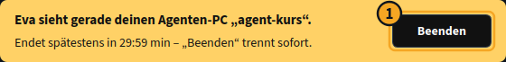{width=65%}

**„Beenden“** ① trennt sofort. Die Hilfe endet auch von selbst, wenn

- die Kursleitung beendet,
- der Kurs pausiert oder beendet wird,
- du den Kursraum verlässt,
- spätestens nach **30 Minuten**.

::: datenschutz
**Was deine Zustimmung bedeutet:** Die Kursleitung sieht **nur den einen Agent-PC**, mit dem du am Kurs teilnimmst
– nie deinen eigenen Bildschirm, deine anderen Fenster oder deine Dateien. Bei „Nur ansehen“ kommen ihre Eingaben
gar nicht an. Bei „Ansehen und bedienen“ kann sie im Agent-PC alles tun, was du dort auch tun kannst – stimm dem
also nur zu, wenn du ihr vertraust, und lass in diesem Agent-PC keine privaten Daten offen. Aufgezeichnet wird
nichts. Bony's Agents notiert nur bei dir, wann wer zugesehen hat (ohne Bildinhalte).
:::

## Schulung im eigenen Netz

Bei einer Schulung im selben Raum (oder im selben VPN) läuft alles direkt zwischen den Rechnern – ohne
Bony-Netz und ohne Internet.

**Vorlage vom Kursleiter laden:** **„Kurse“** → **„Schulung im Netzwerk beitreten …“**. Im selben Netz erscheint
die Freigabe von selbst. Wähle sie aus, gib den **Freigabe-Code** ein, den die Kursleitung zeigt, und klicke auf
**„Verbinden“**.

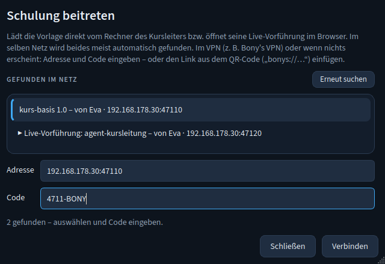{width=70%}

Vergleiche danach den **Fingerabdruck** mit dem auf dem Bildschirm der Kursleitung und setze das Häkchen. Klicke
auf **„Laden und importieren“**. Aus der geladenen Vorlage entsteht dein Agent-PC in wenigen Minuten.

Gibt die Kursleitung ein **Kurspaket** mit frei, steht es unter den Angaben zur Vorlage. Es kommt mit in deine
Bibliothek, und Bony's Agents bietet an, es gleich durchzuarbeiten. Die Kursleitung sieht dann deine Lektion und ob
die Prüfaufgabe geschafft ist – solange ihre Freigabe läuft.

**Vorführung ansehen:** Die Kursleitung zeigt dir eine Adresse wie `https://192.168.178.30:47120` und einen QR-Code.
Öffne die Adresse im Browser (oder scanne den QR-Code mit dem Handy), gib deinen Namen und den Code ein. Der
Browser warnt vor dem Zertifikat (Brave: „Dies ist keine sichere Verbindung“, Firefox: „Warnung: Mögliches
Sicherheitsrisiko erkannt“) – das ist hier normal: „Erweiterte Informationen“ bzw. „Erweitert“ → „Weiter zu …“.
Du kannst nur zusehen. Ton ist nicht dabei.

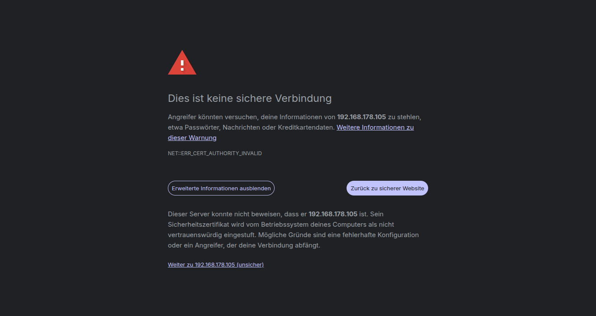{width=70%}

**Hilfe anfordern:** In der Detailansicht deines laufenden Agent-PCs **„Hilfe anfordern …“** → Kurs auswählen
(im selben Netz wird er gefunden), Code eingeben, optional eine kurze Nachricht → **„Hilfe anfordern“**.

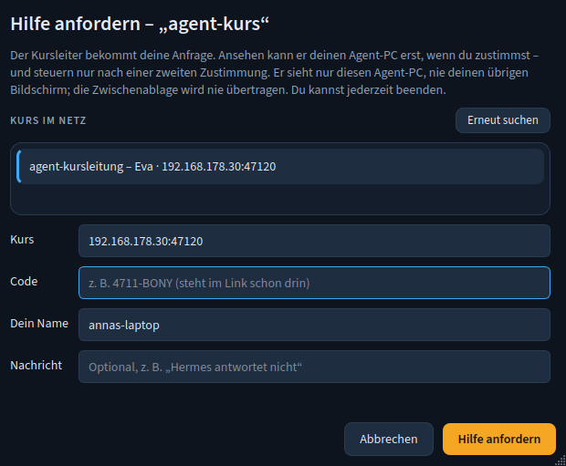{width=70%}

Möchte die Kursleitung zusehen, fragt Bony's Agents: **„Erlauben“** oder **„Ablehnen“**. Fürs Steuern kommt eine
zweite, eigene Frage. Solange jemand zusieht, steht oben im Hauptfenster ein farbiger Hinweis mit **„Nur ansehen“**
und **„Beenden“**.

# Datenschutz in einfachen Worten

Bony's Agents hat **keine Telemetrie**, **keine Werbung** und **kein Konto**. Fehler werden nur bei dir auf dem
Rechner notiert und nirgends hingeschickt.

Ins Internet geht nur das:

| Wann? | Wohin? | Was? |
|---|---|---|
| Update-Suche (nur, wenn du zugestimmt hast) | GitHub | die Frage nach der neuesten Version – dabei deine IP-Adresse und deine Version |
| Update installieren (nur nach deiner Zustimmung) | GitHub bzw. die Paketquelle | Download |
| Neuen Agent-PC einrichten | Debian und die offiziellen Quellen der Programme | Downloads – der Agent-PC lädt sie selbst |
| Bony-Netz (nur, wenn eingeschaltet) | der gewählte Bony-Netz-Server | Instanz, Namen und Adressen deiner Agent-PCs im Netz; bei Kursen Kursname und Anzeigenamen |
| Kursraum | der Kursraum-Server des Kurses | Bild, Ton und Chat – nur, was du einschaltest |
| Schulung im eigenen Netz | nur der Rechner der Kursleitung | dein Rechnername bzw. der Name, den du eingibst; mit Kurspaket deine Lektion und „geschafft / noch nicht“ |
| Kurspakete aus dem Internet (nur auf Klick) | GitHub (Repository bonys-agents-kurspakete) | die Liste der Kurspakete bzw. den Download |
| Kurs mit Kurspaket | der Bony-Netz-Server | deine Lektion und ob die Prüfaufgabe geschafft ist |

**Was im Agent-PC passiert**, entscheidest du: Die KI und der Browser im Agent-PC schicken Daten an die Dienste,
die du dort benutzt (zum Beispiel an den Anbieter deines KI-Modells).

**Deine Rechte in Kursen:** Ohne deine Zustimmung sieht niemand deinen Agent-PC. Deinen eigenen Rechner erreicht
die Kursleitung nie. Andere Teilnehmer erreichen deinen Agent-PC nie.

# Häufige Fragen und Probleme

## „Keine Hardware-Virtualisierung“ oder alles ist sehr langsam

Die Virtualisierung ist im **BIOS/UEFI** ausgeschaltet. Starte den Rechner neu, öffne das BIOS (meist mit Entf,
F2 oder F10 beim Start) und schalte **Intel VT-x** bzw. **AMD-V/SVM** ein. Das kann kein Programm für dich tun.
Ohne Beschleunigung (unten in der Statuszeile steht „Beschleuniger: tcg“) dauert die Einrichtung Stunden.

## Die Einrichtung dauert sehr lange oder hängt

15 bis 60 Minuten sind normal. Steht der Fortschritt lange still, klicke auf **„Trotzdem anzeigen“** und schau
in die Konsole. **„Einrichtungsprotokoll holen“** kopiert die Protokolle in den Ordner des Agent-PCs,
**„Protokolle öffnen“** zeigt ihn.

## Programme hängen oder ein Fenster geht nicht auf

Meist ist der **Arbeitsspeicher** des Agent-PCs zu knapp – etwa wenn Brave, n8n und Hermes gleichzeitig laufen.
Steht in der Detailansicht beim Arbeitsspeicher **„⚠ empfohlen: …“**, klicke daneben auf **„Leistung ändern …“**,
dann auf **„Empfehlung übernehmen“** und **„Übernehmen und neu starten“**. Bony's Agents fährt den Agent-PC
herunter und startet ihn mit mehr Arbeitsspeicher neu. Speichere vorher offene Dateien im Agent-PC.

Hängt nur ein Programm, hilft oft schon: das Programm ganz schließen und noch einmal starten.

## Mein Agent-PC erscheint nicht im Bony-Netz

1. Ist das Bony-Netz an und eine Instanz angelegt? (ⓘ → „Bony-Netz …“)
2. Läuft der Agent-PC? Aus ist er „offline“.
3. Steht in der Liste „nicht verbunden“: Rechtsklick → **„Mit dem Bony-Netz verbinden“**.
4. Klappt es weiterhin nicht, steht der Grund im Protokoll **im Agent-PC**. Öffne dort ein Terminal und gib ein:
   `sudo cat /var/log/bony-netz-beitritt.log`
5. Ist im Agent-PC der **Kill-Switch** von Bony's VPN an, aber kein Tunnel verbunden, kommt auch das Bony-Netz
   nicht ins Internet. Erst den Tunnel verbinden.

## „Der Kurscode ist ungültig oder abgelaufen“ / „Der Kurs ist voll“

Diese Meldungen kommen vom Server. Prüfe den Code (Tippfehler?) und frag deine Kursleitung – sie kann einen neuen
Kurs mit neuem Code anlegen.

## Der Kursraum lässt sich nicht öffnen

- „Der Kurs läuft gerade nicht“: Die Kursleitung hat noch nicht gestartet oder pausiert.
- Unter **Linux auf ARM** (zum Beispiel Raspberry Pi) gibt es den Kursraum noch nicht.
- Kamera oder Mikrofon gehen nicht: Wird das Gerät gerade von einem anderen Programm benutzt (Zoom, Teams …)?
  Unter macOS die Erlaubnis in den Systemeinstellungen prüfen.

## Der Browser warnt „Verbindung nicht privat“

Das passiert nur bei der Vorführung im eigenen Netz. Jede Vorführung hat ihr eigenes Zertifikat. Wer sicher gehen
will, vergleicht den Fingerabdruck in den Zertifikatsdetails mit dem auf dem Bildschirm der Kursleitung.

## Wo liegen meine Daten?

| System | Ordner |
|---|---|
| Linux | `~/.local/share/bonys-agents/` |
| macOS | `~/Library/Application Support/bonys-agents/` |
| Windows | `%LOCALAPPDATA%\bonys-agents\` |

Jeder Agent-PC hat dort einen Unterordner in `vms/`. Liegt ein Agent-PC auf einer externen SSD, findet Bony's
Agents ihn dort von selbst, sobald die SSD eingesteckt ist.

## Wie deinstalliere ich Bony's Agents?

Wie jedes andere Programm (Windows: Einstellungen → Apps; Linux: Softwareverwaltung; macOS: aus „Programme“ in
den Papierkorb). **Deine Agent-PCs bleiben dabei erhalten.** Willst du auch sie loswerden, lösche sie vorher in der
App.

## Ich möchte selbst Kurse geben

Dafür gibt es **Bony's Agents Kursleiter** und das Kursleiter-Handbuch. Im Menü ⓘ führt
„Du möchtest selbst Schulungen geben?“ zum Download.

# Glossar

**Agent-PC**
: ein eigener, abgeschotteter Rechner im Fenster (virtuelle Maschine), in dem eine KI arbeiten darf.

**API-Schlüssel**
: eine Art Passwort, mit dem ein Programm (zum Beispiel Hermes) einen KI-Dienst benutzen darf.

**Bony-Netz**
: privates Netz über das Internet für Kurse. Standardmäßig aus.

**Fingerabdruck**
: eine Prüfnummer für eine verschlüsselte Verbindung. Stimmt sie mit der auf dem Bildschirm der Kursleitung
  überein, ist die Verbindung echt.

**Freigabe-Code**
: kurzer Code für eine Schulung im eigenen Netz, zum Beispiel `4711-BONY`.

**Instanz**
: deine Anmeldung bei einem Bony-Netz-Server – ohne Name, E-Mail oder Passwort.

**Kurs**
: eine Veranstaltung mit Kursleitung – über das Internet (Kurscode) oder im eigenen Netz (Freigabe-Code).

**Kurspaket**
: der Inhalt zum Lernen: Lektionen mit Anleitung, Prüfaufgaben, Quiz und Handout. Als Datei `.bonyspaket`. Geht
  allein (Selbstlern-Modus) oder in einem Kurs.

**Kill-Switch**
: Sperre, die ohne verbundenen VPN-Tunnel jeden Internetverkehr verhindert.

**Kurscode**
: Code, mit dem du einem Kurs über das Internet beitrittst, zum Beispiel `K7QX-M3PA`.

**Kursleiter-Code**
: Code vom Betreiber des Servers, mit dem jemand Kurse anlegen darf.

**Kursraum**
: das Fenster für Bild, Ton, Kamera und Chat während eines Kurses.

**Lektion**
: ein Abschnitt eines Kurspakets mit Anleitung, oft mit Prüfaufgabe und Quiz.

**Modell**
: das „Gehirn“ einer KI. Es läuft bei einem Anbieter im Internet.

**Prüfaufgabe**
: kleine Kontrolle im Agent-PC, ob eine Aufgabe geschafft ist – Ergebnis nur „geschafft“ oder „noch nicht“.

**QEMU**
: das freie Programm, das Agent-PCs laufen lässt.

**RDP / SPICE**
: zwei Wege für den Fernzugriff auf einen Agent-PC.

**Selbstlern-Modus**
: ein Kurspaket allein durcharbeiten, ohne Kurs und ohne Kursleitung.

**Startzustand**
: der gesicherte Stand des Agent-PCs zu Beginn einer Lektion – „Zurücksetzen“ kehrt dorthin zurück.

**Vorlage**
: ein fertig eingerichteter Agent-PC zum Kopieren.

**.bonys-Datei**
: eine Vorlage als eine einzige Datei zum Weitergeben.

**.bonyspaket-Datei**
: ein Kurspaket als eine einzige Datei zum Weitergeben.

**Zentrale**
: der Teil des Bony-Netz-Servers, der Instanzen, Agent-PCs und Kurse verwaltet.
