<!-- SPDX-License-Identifier: CC-BY-SA-4.0 -->
<!-- Quelltext des Kursleiter-Handbuchs. PDF: docs/handbuch/erstellen.sh. Die Bilder mit „kl-“ zeigen die
     Kursleiter-Version. -->

# Einführung

## Was die Kursleiter-Version zusätzlich kann

**Bony's Agents Kursleiter** enthält alles aus der normalen Version und dazu die Werkzeuge, um selbst Kurse zu
geben. Deine Teilnehmer brauchen nur die normale Version.

| Funktion | Bony's Agents | Kursleiter |
|---|:---:|:---:|
| Agent-PCs, Vorlagen, Fernzugriff, VPN, Mission Control | ✓ | ✓ |
| An Kursen teilnehmen, Kursraum, Hilfe anfordern | ✓ | ✓ |
| Kursleiter-Code einlösen, Kurse anlegen, starten, pausieren, beenden | – | ✓ |
| Im Kursraum: Bildschirm teilen, stumm schalten, Sprechen freigeben, aus dem Raum nehmen | – | ✓ |
| „Helfen“: Agent-PC eines Teilnehmers ansehen und bedienen (nach Zustimmung) | – | ✓ |
| Schulung im eigenen Netz: Vorlage freigeben, vorführen, Hilfe-Anfragen annehmen | – | ✓ |

Dieses Handbuch setzt voraus, dass du die normalen Funktionen kennst (Benutzerhandbuch: Agent-PC erstellen,
Hermes einrichten, Bony-Netz einschalten).

## Zwei Arten von Kursen

| | **Kurs über das Internet** (Bony-Netz) | **Schulung im eigenen Netz** |
|---|---|---|
| Wo sitzen die Leute? | jeder an seinem Ort | im selben Raum (WLAN) oder im selben VPN |
| Server | ein Bony-Netz-Server (Zentrale und Kursraum) | keiner – alles direkt zwischen den Rechnern |
| Was brauchst du? | Kursleiter-Code vom Server-Betreiber | nur die Kursleiter-Version |
| Bild und Ton | Kursraum: Bildschirm, Ton, Kameras, Chat, Handzeichen | Vorführung im Browser, ohne Ton |
| Hilfe | „Helfen“ im Kursraum | Hilfe-Schalter |
| Vorlage verteilen | als `.bonys`-Datei (USB-Stick, Cloud) | direkt mit „Im Netzwerk freigeben“ |

**Faustregel:** Kurse über das Internet nehmen dir viel Technik ab und funktionieren auch, wenn alle zu Hause
sitzen. Die Schulung im eigenen Netz ist der Weg, wenn es vor Ort kein zuverlässiges Internet gibt.

# Einrichten

## Kursleiter-Version installieren

Lade auf der Releases-Seite die Datei mit **„Kursleiter“** im Namen:

| System | Datei |
|---|---|
| Windows | `BonysAgents-Kursleiter-Setup-<Version>.exe` |
| Debian, Ubuntu, Linux Mint | `bonys-agents-kursleiter_<Version>_amd64.deb` |
| macOS | `BonysAgents-Kursleiter-<Version>-macos-applesilicon.dmg` bzw. `-intel.dmg` |

Die Installation geht wie bei der normalen Version (Benutzerhandbuch, Kapitel „Installation“). Hast du die normale
Version schon, installierst du die Kursleiter-Version einfach darüber: Sie ersetzt die normale. Agent-PCs, Vorlagen
und Einstellungen bleiben. Umgekehrt geht es genauso.

Im Hauptfenster steht dann unter dem Namen **„Kursleiter“**. Neu ist der Knopf **„Vorführen …“** ① beim Agent-PC.
Kurse leitest du über **„Kurse“** ②, Vorlagen verteilst du über **„Vorlagen“** ③:

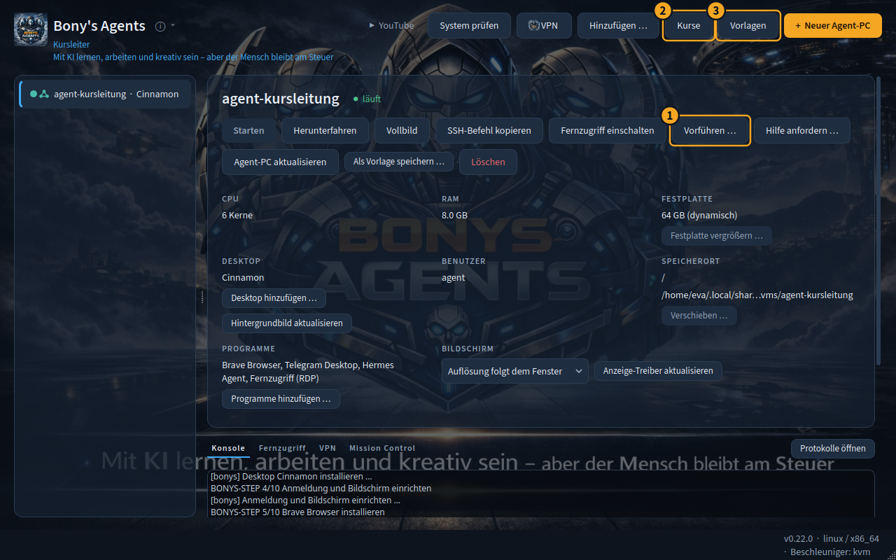

## Bony-Netz und Instanz

Für Kurse über das Internet brauchst du wie deine Teilnehmer: Menü ⓘ → **„Bony-Netz …“** → „Bony-Netz verwenden“,
Server prüfen, **„Instanz anlegen“** (Benutzerhandbuch, Kapitel „Bony-Netz“).

Erstelle außerdem einen **Agent-PC im Bony-Netz**, mit dem du vorführst – zum Beispiel `agent-kursleitung`.

## Deinen Rechner ins Bony-Netz bringen

Für **„Helfen“** muss **dein eigener Rechner** im Bony-Netz sein, nicht nur dein Agent-PC – sonst erreicht das
Betrachter-Fenster die Agent-PCs der Teilnehmer nicht.

- **Linux:** mit **Bony's VPN**. In Bony's VPN unter „Bony-Netz“ **„Diesen Rechner verbinden“** einschalten. Bony's
  VPN öffnest du über den Knopf **„VPN“** oben im Hauptfenster (ist es nicht installiert, bietet Bony's Agents die
  Installation an).
- **Windows und macOS:** mit der offiziellen **Tailscale-App**, angemeldet am Anmeldeserver deines Bony-Netzes.

Beim **„Kurs starten“** prüft Bony's Agents das und weist dich darauf hin, wenn dein Rechner nicht im Netz ist:

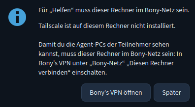{width=55%}

## Kursleiter-Code einlösen

Kurse anlegen darf eine Instanz erst mit einem **Kursleiter-Code**. Den bekommst du vom Betreiber deines
Bony-Netz-Servers. Einmal einlösen genügt – auch für Bony's VPN.

1. Klicke im Hauptfenster auf **„Kurse“**. Der Reiter **„Kursleitung“** ist geöffnet.
2. Gib den Code ins Feld **„Kursleiter-Code“** ① ein.
3. Klicke auf **„Einlösen“** ②.

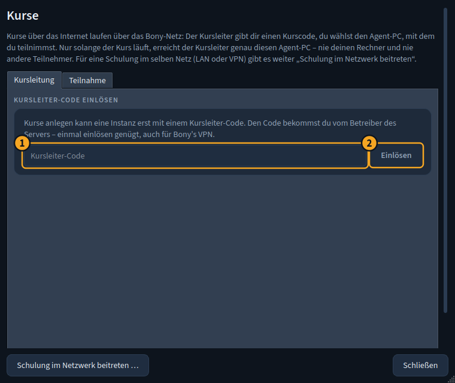{width=75%}

Danach siehst du die Kursliste. Bei „Bony-Netz …“ steht jetzt „Kursleiter: ja“.

# Einen Kurs vorbereiten

## Den Kurs-Agent-PC vorbereiten

Überlege, womit deine Teilnehmer arbeiten sollen. Zwei Wege:

- **Jeder richtet sich selbst einen Agent-PC ein** (normaler Weg, siehe Handout des Beispielkurses). Das dauert bei
  jedem 15–60 Minuten und muss **vor** dem Kurs passieren.
- **Du verteilst eine Vorlage:** Richte einen Agent-PC so ein, wie er im Kurs sein soll, speichere ihn als Vorlage
  (mit „Persönliche Daten entfernen“) und gib sie mit **„Vorlagen“ → „Weitergeben (.bonys) …“** als Datei weiter.
  Die Teilnehmer importieren sie und haben in Minuten denselben Agent-PC.

::: warnung
In einer weitergegebenen Vorlage darf **nichts Persönliches** stecken: keine Anmeldungen, keine API-Schlüssel. Bony's
Agents prüft das beim Weitergeben in einer Kopie und bricht ab, wenn es etwas findet. Programme, die nicht frei
weitergegeben werden dürfen (Claude Code, Obsidian), nimmt es heraus – die Teilnehmer installieren sie dann aus der
offiziellen Quelle.
:::

## Einen Kurs anlegen

1. **„Kurse“** → Reiter **„Kursleitung“** → **„+ Neuer Kurs …“**.
2. **Kursname** ①: zum Beispiel „Einführung in Hermes Agent“.
3. **Dein Anzeigename** ②: so sehen dich die Teilnehmer.
4. **Code gültig für** ③: 1 bis 60 Tage (Standard 14). So lange können Teilnehmer mit dem Code beitreten.
5. **„Kurs anlegen“** ④.

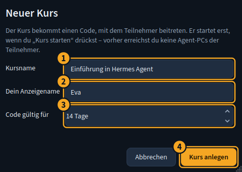{width=60%}

Der Kurs ist jetzt **offen**: Teilnehmer können beitreten, aber du erreichst ihre Agent-PCs noch nicht. Erst mit
„Kurs starten“ beginnt der Kurs.

In der Kursliste siehst du alle deine Kurse mit Status, Teilnehmerzahl und Code. **„+ Neuer Kurs …“** ①, **„Öffnen“**
② öffnet die Kursansicht, **„Beendete anzeigen“** ③ zeigt auch alte Kurse:

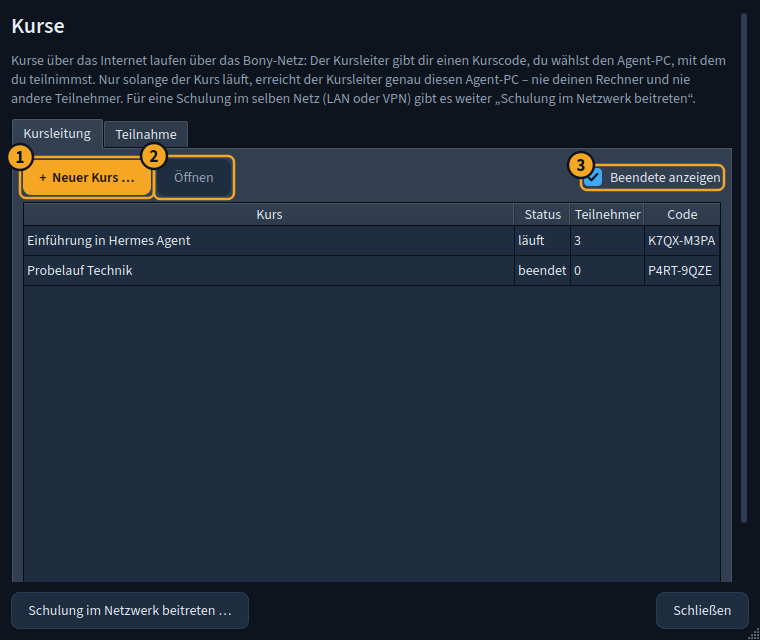{width=75%}

## Den Code verteilen

Öffne den Kurs. Oben steht der **Kurscode** ① groß, daneben **„Kopieren“**. Darunter siehst du, bis wann er gilt.

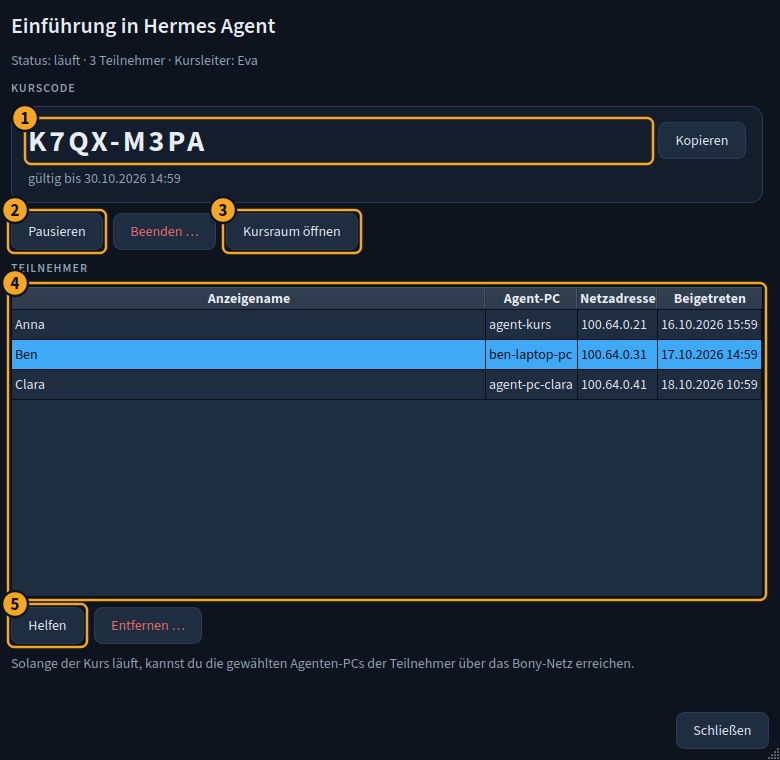{width=80%}

Schicke deinen Teilnehmern den Code rechtzeitig vor dem Kurs, zusammen mit dem Handout (siehe Beispielkurs). Eine
Vorlage für die Einladung:

> **Betreff:** Einladung: Einführung in Hermes Agent am Samstag, 8. November, 10–12 Uhr
>
> Hallo,
>
> schön, dass du beim Kurs „Einführung in Hermes Agent“ dabei bist. Wir treffen uns online im Kursraum von
> Bony's Agents.
>
> **Bitte bis spätestens zwei Tage vorher erledigen** (dauert ca. 1 Stunde, das meiste davon Warten):
>
> 1. Bony's Agents installieren: github.com/zappotex/BonysAgents/releases/latest
> 2. Im Menü ⓘ → „Bony-Netz …“ das Bony-Netz einschalten und „Instanz anlegen“ klicken.
> 3. „+ Neuer Agent-PC“ mit Häkchen „Mit dem Bony-Netz verbinden“ erstellen und warten, bis er fertig ist.
> 4. „Kurse“ → Kurscode eingeben: **K7QX-M3PA** → deinen Agent-PC wählen → „Beitreten“.
>
> Am Kurstag: Bony's Agents öffnen, Agent-PC starten, „Kurse“ → „Kursraum betreten“. Ein Headset ist gut, eine
> Kamera ist freiwillig.
>
> Im Anhang findest du ein Handout mit allen Schritten. Wenn etwas nicht klappt, antworte einfach auf diese Mail.
>
> Viele Grüße
> Eva

## Wie viele Teilnehmer?

Wie viele Teilnehmer ein Kurs haben darf und wie viele aktive Kurse du gleichzeitig haben kannst, legt der
**Server** fest, nicht die App. Ist eine Grenze erreicht, zeigt Bony's Agents die Meldung des Servers unverändert
an, zum Beispiel „Der Kurs ist voll“. Frag deinen Server-Betreiber, welche Grenzen gelten.

Für einen Kurs mit Bildschirm und Kameras sind **5–10 Teilnehmer** gut zu betreuen. Bei mehr Leuten lieber
Kameras aus und „Sprechen nur nach Freigabe“ an.

## Technik-Check vorab

Mach ein bis zwei Tage vor dem Kurs einen **Probelauf** – am besten mit einem zweiten Rechner oder einer
Freiwilligen:

1. Kurs starten, Kursraum öffnen, Mikrofon und Bildschirm teilen ausprobieren.
2. Mit dem zweiten Rechner beitreten: Sieht man deinen Bildschirm? Hört man dich?
3. „Helfen“ ausprobieren: Kommt die Rückfrage an? Siehst du den Agent-PC?
4. Kurs wieder **pausieren** (oder einen eigenen Probekurs danach beenden).

Schau in der Kursansicht nach, ob bei allen angemeldeten Teilnehmern eine **Netzadresse** steht. Fehlt sie, ist
der Agent-PC des Teilnehmers nicht im Bony-Netz.

# Vor Ort oder über das Internet

## Alle sitzen im selben Raum

Auch wenn alle im selben Raum sind, kannst du einen Kurs über das Internet machen. Dann gilt:

- **Viele Rechner am selben Internetanschluss:** Für den Server sehen alle Teilnehmer gleich aus (dieselbe
  öffentliche IP-Adresse). Server begrenzen oft, wie viele **Instanzen pro Tag** von einer Adresse angelegt werden
  dürfen. Bitte deinen **Server-Betreiber**, die Grenze „Instanzen pro Tag“ für deinen Kurstag zu erhöhen – oder
  lass die Teilnehmer ihre Instanz schon zu Hause anlegen. In Bony's Agents selbst gibt es diese Einstellung nicht.
- **WLAN:** Jeder Agent-PC lädt bei der Einrichtung mehrere hundert Megabyte. Zehn Agent-PCs gleichzeitig im
  selben WLAN dauern lange. Lass die Agent-PCs vorher einrichten oder verteile eine Vorlage.
- **Ton:** Im selben Raum brauchst du den Ton des Kursraums nicht. Lass alle Mikrofone aus, sonst gibt es
  Rückkopplungen. Den Bildschirm kannst du trotzdem teilen – oder einfach per Beamer zeigen.
- **Kein Internet vor Ort?** Dann nimm die **Schulung im eigenen Netz** (Kapitel 5.6).

## Alle sitzen zu Hause

- Bitte um ein **Headset** – das verhindert Echo.
- Rechne mit **10 Minuten Technik** am Anfang. Starte den Kurs 15 Minuten früher.
- Lege einen **Plan B** fest, zum Beispiel einen Jitsi-Raum (meet.jit.si) für Ton und Bild, falls der Kursraum
  streikt.
- Bitte die Teilnehmer, ihren Agent-PC **vor** dem Kurs zu starten. Für „Helfen“ muss er laufen.

# Während des Kurses

## Kurs starten, pausieren, beenden

In der Kursansicht:

| Knopf | Wirkung |
|---|---|
| **Kurs starten** | Der Kurs läuft: Kursraum offen, du erreichst die gewählten Agent-PCs der Teilnehmer über das Bony-Netz. |
| **Pausieren** ② | Zugang zu den Agent-PCs sofort weg, niemand kann neu in den Kursraum. „Kurs starten“ setzt fort. |
| **Beenden …** | Kurs endgültig zu – mit Rückfrage. Lässt sich nicht rückgängig machen. |
| **Kursraum öffnen** ③ | öffnet das Fenster „Kursraum“ (nur, solange der Kurs läuft) |

Unten in der Kursansicht steht die **Teilnehmertabelle** ④ mit Anzeigename, Agent-PC, Netzadresse und
Beitrittszeit. **„Helfen“** ⑤ öffnet den Kursraum und fragt den ausgewählten Teilnehmer. **„Entfernen …“** nimmt
einen Teilnehmer ganz aus dem Kurs.

Teilnehmer erreichen sich untereinander nie. Und du erreichst nur den einen Agent-PC, den ein Teilnehmer beim
Beitreten gewählt hat – nie seinen eigenen Rechner.

## Der Kursraum

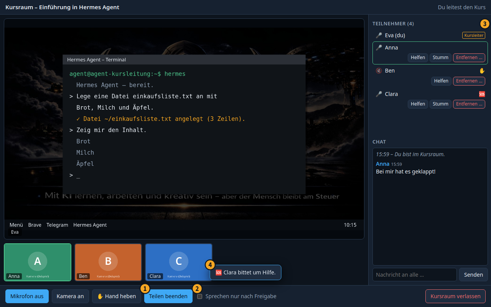

Du kommst **mit Mikrofon an** herein (Teilnehmer mit allem aus). Unten in der Leiste:

- **Mikrofon** und **Kamera** an und aus.
- **✋ Hand heben** – auch für dich, falls du in einem Kurs mit zwei Kursleitungen bist.
- **„Bildschirm teilen“** ①: Wähle einen ganzen Bildschirm oder ein einzelnes Fenster. Mit „Teilen beenden“ hörst du
  auf.

  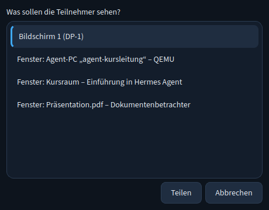{width=50%}

- **„Sprechen nur nach Freigabe“** ②: Ist das Häkchen gesetzt, können Teilnehmer ihr Mikrofon nur einschalten, wenn du
  es ihnen erlaubst. Laufende Mikrofone gehen aus.

::: tipp
Teile lieber ein **einzelnes Fenster** (zum Beispiel das Fenster deines Agent-PCs) als den ganzen Bildschirm. So
sieht niemand versehentlich deine E-Mails oder Benachrichtigungen.
:::

## Teilnehmer steuern

Rechts in der Teilnehmerliste ③ hat jeder Teilnehmer kleine Knöpfe:

| Knopf | Wirkung |
|---|---|
| **Helfen** | fragt den Teilnehmer, ob du seinen Agent-PC sehen darfst (siehe unten) |
| **Sprechen erlauben** / **Freigabe entziehen** | nur bei „Sprechen nur nach Freigabe“ |
| **Stumm** | schaltet sein Mikrofon aus (er kann es selbst wieder einschalten, außer bei „nur nach Freigabe“) |
| **Entfernen …** | nimmt ihn aus dem **Kursraum**. Im Kurs bleibt er und kann wieder eintreten. Ganz aus dem Kurs: Kursansicht → „Entfernen …“ |

**✋** neben einem Namen heißt: Der Teilnehmer meldet sich. **🆘** heißt: Er bittet um Hilfe. Beides meldet der
Kursraum auch kurz mit einem Hinweis ④.

## Chat

Der Chat ist für alle im Raum. Er wird **nicht gespeichert** – wer später kommt, sieht frühere Nachrichten nicht,
und mit dem Fenster ist er weg. Schicke wichtige Links deshalb lieber auch per E-Mail.

## Helfen

Mit **„Helfen“** siehst du den Agent-PC eines Teilnehmers in einem eigenen Fenster – und kannst ihn bedienen, wenn
er das erlaubt.

1. Klicke im Kursraum beim Teilnehmer auf **„Helfen“** (oder in der Kursansicht: Teilnehmer wählen → „Helfen“).
   Der Knopf zeigt „Frage …“.
2. Beim Teilnehmer erscheint die Rückfrage: **„Nur ansehen“**, **„Ansehen und bedienen“** oder **„Ablehnen“**. Ohne
   Antwort ist sie nach 60 Sekunden abgelehnt.
3. Stimmt er zu, öffnet sich bei dir das Fenster **„Hilfe – Name (Nur ansehen)“** bzw. „(Ansehen und bedienen)“ mit
   seinem Agent-PC. Oben gibt es **„An Fenster anpassen“**, **„Strg+Alt+Entf“** und **„Beenden“**.
4. Der Knopf im Kursraum zeigt „Hilfe läuft“. Lehnt der Teilnehmer ab, erscheint ein Hinweis.

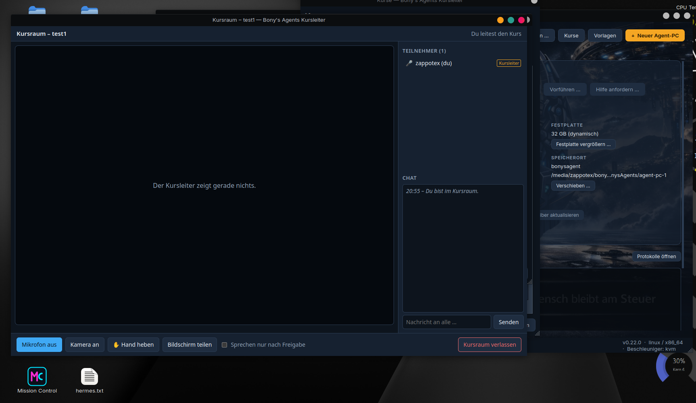

Die Hilfe endet, wenn du oder der Teilnehmer „Beenden“ drückt, der Kurs pausiert oder beendet wird, einer von euch
den Kursraum verlässt, oder spätestens nach 30 Minuten.

::: datenschutz
Frag **jedes Mal neu** – und sag vorher laut, was du tun möchtest („Ich schau mir kurz dein Terminal an“). Wähle
„Ansehen und bedienen“ nur, wenn es wirklich nötig ist. Du siehst nur den Agent-PC, mit dem der Teilnehmer am Kurs
teilnimmt – nichts von seinem eigenen Rechner. Aufgezeichnet wird nichts.
:::

## Schulung im eigenen Netz

Ohne Bony-Netz, im selben WLAN oder VPN. Alle Teilnehmer finden deine Angebote unter **„Kurse“ → „Schulung im
Netzwerk beitreten …“**.

**Vorlage freigeben:** **„Vorlagen“** → Vorlage wählen → **„Im Netzwerk freigeben …“** → „Freigabe starten“. Die
Vorlage wird dafür einmal geprüft und verpackt. Dann zeigt das Fenster den **Freigabe-Code** ①, den **QR-Code** ②
(enthält Adresse, Code und Fingerabdruck) und die **Teilnehmer** ③ mit Fortschritt:

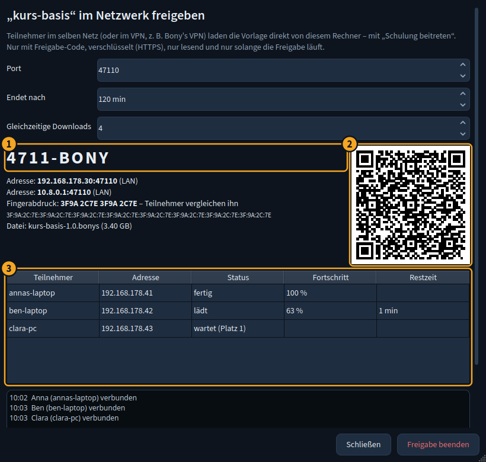{width=80%}

Höchstens 4 Teilnehmer laden gleichzeitig (einstellbar), die anderen warten in einer Schlange. Die Freigabe endet
nach 120 Minuten von selbst oder mit „Freigabe beenden“.

**Vorführen:** Agent-PC starten → **„Vorführen …“** → Qualität, Zuschauerzahl, Dauer wählen → „Vorführung
starten“. Die Teilnehmer öffnen die angezeigte Adresse im Browser (oder scannen den QR-Code) und sehen deinen
Agent-PC – **nur ansehen**, ohne Ton.

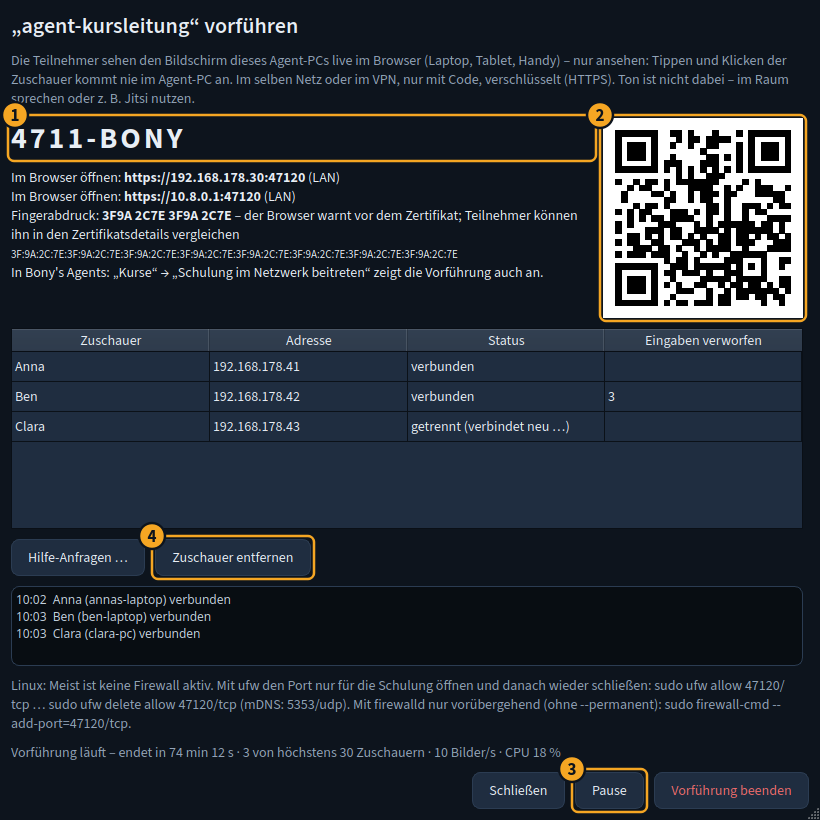{width=80%}

- **Code** ① und **QR-Code** ② zum Weitergeben.
- **„Pause“** ③: Alle sehen sofort nur noch „Gleich geht's weiter …“. Drück Pause, **bevor** du Passwörter oder
  API-Schlüssel eingibst.
- **„Zuschauer entfernen“** ④: trennt den gewählten Zuschauer (seine Adresse ist 5 Minuten gesperrt).

**Hilfe-Anfragen:** Menü ⓘ → **„Kursleitung: Hilfe-Anfragen …“** → „Hilfe-Schalter starten“ (läuft schon eine
Vorführung, gilt derselbe Code). Neue Anfragen erscheinen mit Hinweiston in der Liste ①. **„Ansehen“** ② fragt den
Teilnehmer und öffnet nach seiner Zustimmung seinen Agent-PC im Browser. **„Steuerung anfragen“** ③ bittet um eine
zweite Zustimmung für Maus und Tastatur.

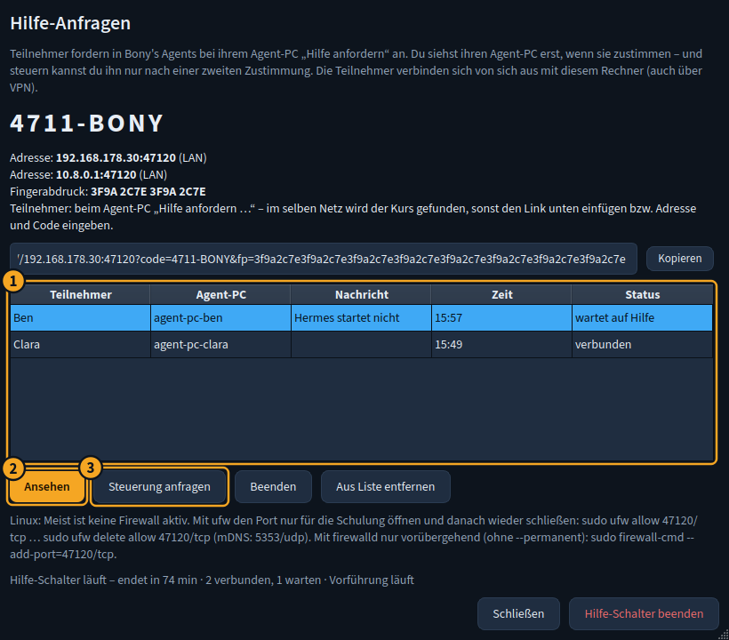{width=80%}

::: hinweis
**Firewall:** Bony's Agents öffnet nichts dauerhaft. Windows fragt beim ersten Freigeben – „Zugriff zulassen“, nur
für **private Netzwerke**. Unter Linux ist meist keine Firewall aktiv; die Fenster zeigen die passenden Befehle für
ufw und firewalld. Im VPN funktioniert die automatische Suche nicht: Die Teilnehmer geben dann die VPN-Adresse aus
dem Fenster ein oder fügen den Link aus dem QR-Code ein.
:::

# Nach dem Kurs

## Kurs beenden

Kursansicht → **„Beenden …“** → Rückfrage bestätigen. Dann gilt sofort:

- Du erreichst **keinen Agent-PC** der Teilnehmer mehr.
- Der **Kursraum wird geschlossen.** Wer noch drin ist, sieht „Der Kursraum wurde geschlossen – der Kurs ist beendet
  oder pausiert.“ Ein neuer Eintritt ist nicht mehr möglich.
- Eine laufende **Hilfe endet.**
- Der **Kurscode** gilt nicht mehr.

Das lässt sich nicht rückgängig machen. Für einen Folgetermin legst du einen neuen Kurs an. Mit **„Beendete
anzeigen“** in der Kursliste siehst du alte Kurse weiter.

Die **Agent-PCs der Teilnehmer bleiben** bei ihnen – mit allem, was sie im Kurs gemacht haben. Sie können damit zu
Hause weiterüben. Auch ihre Instanz im Bony-Netz bleibt; nur die Verbindung zu deinem Kurs ist weg.

## Aufräumen

- Schulung im eigenen Netz: Freigabe, Vorführung und Hilfe-Schalter enden mit dem Fenster bzw. nach der
  eingestellten Zeit von selbst.
- Hast du für die Schulung Ports in der Firewall geöffnet, schließe sie wieder.
- Hast du in deinem Vorführ-Agent-PC API-Schlüssel eingegeben, die du nicht behalten möchtest: dort löschen
  (`hermes setup` bzw. `~/.hermes/.env`) oder den Agent-PC neu aus der Vorlage erstellen.

# Bekannte Grenzen

- **Bildschirm teilen unter Linux geht nur in einer X11-Sitzung** (zum Beispiel Cinnamon oder „GNOME on Xorg“), nicht
  unter **Wayland**. Der Knopf erklärt das dann. Kamera, Ton und Chat gehen trotzdem. Abhilfe: beim Anmelden die
  X11-Sitzung wählen.
- **Linux auf ARM** (zum Beispiel Raspberry Pi): Den Kursraum – und damit auch „Helfen“ – gibt es dort noch
  nicht. Nimm zum Leiten einen anderen Rechner (Linux auf x86, Windows oder macOS).
- **macOS:** Beim ersten Mal Kamera, Mikrofon und **Bildschirmaufnahme** erlauben (Systemeinstellungen →
  Datenschutz & Sicherheit).
- **Pausieren:** Ob der Server beim Pausieren auch den Kursraum schließt, hängt vom Server ab. Neue Eintritte lehnt er
  in jedem Fall ab.
- **Vorführung im eigenen Netz:** kein Ton. Nutze den Raum oder zusätzlich Jitsi.
- **Kill-Switch** von Bony's VPN im Agent-PC eines Teilnehmers: Ohne verbundenen Tunnel kommt auch das Bony-Netz
  nicht durch.
- **Noch wenig erprobt** (Stand dieser Version): Kursraum und „Helfen“ unter Windows und macOS sind bisher nur
  unter Linux ausführlich getestet. Mach dort unbedingt vorher einen Probelauf.

# Checkliste zum Ausdrucken

**Kurs:** ______________________________ **Datum:** ______________ **Kurscode:** ______________

## Vor dem Kurs (1–2 Wochen vorher)

- [ ] Kursleiter-Version installiert, Bony-Netz an, Kursleiter-Code eingelöst
- [ ] Eigener Rechner im Bony-Netz (Bony's VPN bzw. Tailscale) – für „Helfen“
- [ ] Vorführ-Agent-PC eingerichtet, Hermes läuft, keine privaten Daten darin
- [ ] Kurs angelegt, Code-Gültigkeit reicht bis nach dem Kurstag
- [ ] Einladung mit Code und Handout verschickt
- [ ] Bei vielen Teilnehmern am selben Anschluss: Server-Betreiber wegen „Instanzen pro Tag“ gefragt
- [ ] Plan B festgelegt (z. B. Jitsi-Link) und in der Einladung genannt

## Vor dem Kurs (1–2 Tage vorher)

- [ ] Probelauf: Kursraum, Ton, Bildschirm teilen, „Helfen“
- [ ] In der Kursansicht: alle Teilnehmer beigetreten, alle mit Netzadresse
- [ ] Wer fehlt oder keine Netzadresse hat, ist angeschrieben

## Kursbeginn (15 Minuten vorher)

- [ ] Rechner am Strom, Benachrichtigungen aus, private Fenster zu
- [ ] Vorführ-Agent-PC gestartet
- [ ] **„Kurs starten“** gedrückt, Hinweis zum Bony-Netz beachtet
- [ ] **„Kursraum öffnen“**, Mikrofon an, Ton geprüft
- [ ] Bildschirm (besser: ein Fenster) geteilt
- [ ] Bei vielen Teilnehmern: „Sprechen nur nach Freigabe“

## Kursende

- [ ] Fragen beantwortet, Hinweise zum Weiterüben gegeben
- [ ] Laufende Hilfen beendet
- [ ] **„Beenden …“** in der Kursansicht (oder „Pausieren“, wenn es weitergeht)
- [ ] Kursraum geschlossen
- [ ] Vorführ-Agent-PC: eingegebene Schlüssel entfernt
- [ ] Freigabe, Vorführung, Hilfe-Schalter beendet; geöffnete Firewall-Ports wieder zu
